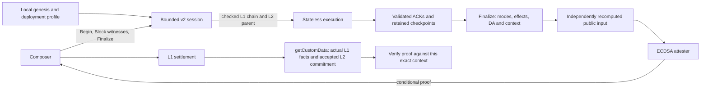

# Architecture

[SPEC.md](../SPEC.md) defines the accepted offline profile. The service retains
v2 execution in bounded sessions, replays every supplied block and independently
checks settlement, DA and the public input before signing. It has no L1 or L2
RPC client and requires only local genesis/profile documents and deployment keys.

## Responsibilities

| Module | Owns |
| --- | --- |
| [main](../src/main.rs), [config](../src/config.rs) | Local profile loading, strict configuration, listener and shutdown |
| [service](../src/service.rs), [worker](../src/service/worker.rs) | Quotas, shared execution permit and blocking-worker cancellation ownership |
| [sessions](../src/service/sessions.rs) | Capabilities, Begin/Block/Finalize, duplicates, Resume/Rewind, epochs, transport lifetime and retained ownership |
| [window](../src/window.rs) | Bounded structural admission; decoding does not authorize execution or signing |
| [stream validation](../src/validate/streaming.rs) | Canonical L1 evidence, authenticated L2 state and incremental checked execution |
| [Stateless adapter](../src/validate/stateless.rs) | Transaction recovery, exact replay, receipts, roots and whole-group checkpoints |
| [offline context](../src/service/l1.rs) | Mode-specific anchor/time/action rules and the exact on-chain context commitment |
| [settlement job](../src/service/settlement_job.rs), [settlement gates](../src/settlement.rs) | Accepted-root binding, ordered effects, observations and native blob DA |
| [attester](../src/attest.rs) | Signing only the typed authorized public input |
| [cancellation](../src/cancel.rs) | Cooperative cancellation of blocking work |

Shared schedule, ancestry and context encodings live in
[eez-protocol](../../eez-protocol/src/l1_history.rs). The same
[execution hook](../../eez-evm/src/history.rs) imports history and checks the
selected PREVRANDAO for stateful production and stateless replay.

## Evidence and authority

1. Begin identifies an execution predecessor by number, hash and state root.
   Those claims alone establish no L1 acceptance.
2. Block admission bounds and decodes the exact bytes. The worker validates
   consecutive canonical L1 headers, the parent history endpoint, source
   selection and complete L2 execution before returning an ACK.
3. The session retains immutable validated blocks, execution witnesses needed
   for target-dependent observation replay and L1 evidence checkpoints. Quotas
   cover this retained data. Exact duplicates cannot change evidence; Rewind
   restores the corresponding evidence prefix.
4. Finalize checks recorded origin membership and exact anchor termination, verifies both the
   selected range and settlement eligibility, and independently recomputes
   observations, effects, blob commitments and public inputs. The accepted L2
   hash must match the replay predecessor or a fully replayed whole-group
   terminal checkpoint, including partial consumption.
5. Only successful complete validation yields attestation material. The async
   owner checks its deadline/cancellation state before signing. A timed-out
   response does not release a blocking worker's permit before it exits.
6. On L1, the manager independently supplies the actual accepted commitment,
   deployment/profile, current rules and anchor facts through getCustomData.
   An inconsistent context produces a different digest and cannot verify.

Composer-controlled headers, witnesses, ranges and ABI are untrusted input.
Local profile documents and keys define deployment authority. Stateless, Reth
and shared protocol code are part of the pinned implementation's trust base.
Network access controls remain responsible for restricting a non-loopback RPC
listener; session IDs are not authentication credentials.

The ECDSA signature attests execution and settlement consistency **conditional
on the bound context**. It does not establish L1 consensus, future inclusion,
future canonicality, successful dispatch or ZK security. No RPC-backed authority,
preparation lease supplements it.

See [request lifecycle](request-lifecycle.md), [data provenance](data-provenance.md)
and [settlement pipeline](settlement-pipeline.md) for detailed invariants.
