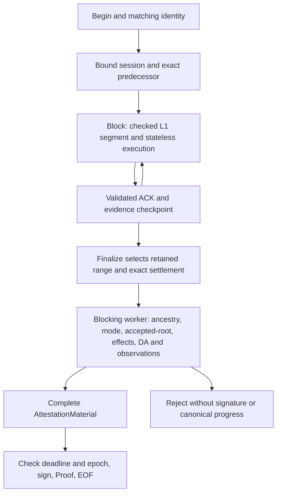

# Request lifecycle

> This is an implementation guide. [`SPEC.md`](../SPEC.md) defines protocol behavior;
> the [v2 runtime contract](../../eez-control-rpc/STREAMING_SPEC.md#6-rollupx-runtime-profile)
> defines transport and resource bounds.

The signer admits bounded v2 streams and sessions. One shared blocking worker
owns expensive validation; Finalize also owns the final-proof request permit.
There is no provider-backed authentication phase or separate preparation API.



## Ownership and publication

Begin creates a volatile session with a bounded retained prefix. Each ordered
Block acquires the shared validation worker, exact-decodes its evidence, executes
and checks continuity before ACK. Finalize acquires its final-proof permit and
shared worker, validates its exact anchor/context and runs the complete settlement
pipeline. The async caller receives checked material and its permit back, checks
deadline/current attachment again, signs and publishes one Proof. A profile-only
hash, decoded calldata or ACK cannot cross the attester boundary.

One operation runs at a time within a session. A bounded queue holds dependent
Block/Finalize frames while control messages can fence work. Resume, Rewind and
Cancel invalidate old attachments. Rewind restores the exact L1 evidence
checkpoint together with L2 execution. Publication rechecks the current epoch
after worker completion and after response backpressure. Rejected operations
leave validated progress unchanged.

## Independent resource bounds

| Bound | Purpose |
| --- | --- |
| Decode ceiling | Limits one encoded message before/while Prost decodes it |
| Session blocks/bytes/items | Limits retained execution and all L1/L2 witness data |
| Frame queues and stream/session counts | Bounds waiting work and attachments |
| Idle and operation timeouts | Bounds silence, output backpressure and each ordered operation |
| Composer settlement cutoff | Bounds the entire attempt, including retries/backfill and L1 delivery |

Known-field accounting does not replace the decode ceiling. Progress does not
extend the absolute operation deadline. Session recovery does not extend the
Composer's original settlement deadline.

## Cancellation and detached work

Dropping an async operation drops its worker guard. The guard aborts queued
blocking work and signals cooperative cancellation for a running job. A running
EVM execution cannot safely be forcefully aborted. Phase boundaries check
cancellation/deadline; individual synchronous work units are not interruptible.

The blocking job retains its validation/request permits until it actually exits,
even if its RPC has timed out or disconnected. Late completion cannot publish
under a cancelled or fenced epoch. A signature completed after the deadline must
not be returned. This prevents retries from creating unbounded detached work.
Half-close instead drains accepted operations. EOF without Proof is failure.

## Session recovery

Sessions and checked artifacts are volatile. Resume reconciles number and hash,
not height alone. A missing/evicted session requires Begin and full witness
backfill. Retained execution never supplies canonical completion. Every Finalize
rechecks the selected range's mode, bridge, accepted-root coverage, settlement
and public inputs. Changing the terminal bridge requires Rewind and resubmission
of that Block. Cold restart uses the same evidence and gates without a local
history database or any L1/L2 RPC connection.

## Actionable settlement rejection

Most settlement rejections are deliberately non-actionable: Composer retains
the held transactions and falls back to its normal recovery path. A safely
attributable `FailedPrecondition` instead carries one typed `ProveFailure` in
the status details:

```text
outbound -> terminal Sync-block user tx index + signed tx hash
inbound  -> PostBatch entry index + canonical entry hash
```

Composer accepts the hint only after both references match the exact rejected
request. An outbound reference directly resolves the outbound held
transaction; its preceding native system load is regenerated with the Sync block.
An inbound reference resolves through the entry-to-held-transaction mapping
that Composer retained while merging inbound source entries.

The resolved transaction and its same-sender, same-direction nonce suffix are
evicted. Composer then reruns simulation, Sync-block construction, settlement
stitching, witness collection, and proving with the remaining candidates. Each
attempt removes at least one candidate, so same-slot recomposition is bounded;
the normal exact-slot proof cutoff still applies. The unchanged rejected
request is never sent through the transient retry loop.

## Graceful shutdown

On Ctrl-C, and SIGTERM on Unix, tonic stops accepting connections. The service
closes attachments, including clients that keep sending or stop reading, and
cancels their async operations. It then waits for admitted/detached blocking
workers and both shared permits. Validation is not terminated halfway through
an execution or settlement gate. See [Operations](operations.md) for process
ownership and retained diagnostic implications.
