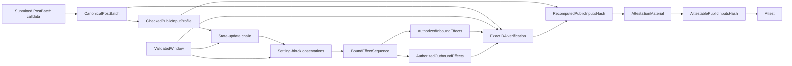

# Settlement pipeline

> This is an implementation guide. [`SPEC.md`](../SPEC.md) is authoritative for
> protocol behavior and compatibility requirements.

Settlement does not “validate the batch” with one broad comparison. It joins
several independently derived views of the same transition. No entry,
checkpoint, event, receipt status, or DA sidecar authorizes an effect by itself.

## Inputs and provenance

| Input | Provenance |
| --- | --- |
| Submitted `PostBatch` calldata | Composer input; `CanonicalPostBatch` proves only complete canonical decoding |
| `ValidatedWindow` | Cross-checked Stateless output plus exact admitted block bytes and locally derived evidence |
| Expected rollup ID, configured proof-system address and proof-system vkey | Independent operator-configured deployment bindings |
| `SystemTransactionReconstructor` | Chain ID, expected rollup ID, and fixed native sender/EEZL2 destination; no key |

## Gate order

[`run_settlement`](../src/service/settlement_job.rs) deliberately stops at the
first failure:

1. `post_batch` exact-decodes and canonical round-trips the full calldata into
   `CanonicalPostBatch`. Its fields remain Composer claims.
2. `CheckedPublicInputProfile` pins the supported one-rollup,
   one-proof-system, supported anchor shape to the expected/configured deployment
   values. It retains the typed capability needed for later hash computation;
   it never accepts the wire hash as authoritative.
3. `state_chain` requires exactly one expected-rollup ABI root update per entry
   and a continuous block-hash chain from
   the terminal ordinary-prefix block hash B[0] to `window_post_block_hash`.
   B[0] includes mandatory pre-execution changes and is not the parent block.
4. `blocks` consumes the validated system-sender flags, receipt outcomes,
   source-table loads, and outbound observations in exact transaction order. It rejects
   privileged/effect evidence in `preceding_blocks` and derives the
   `settling_block` effect-candidate framing once.
5. `effect_binding` enforces the leading-anchor and later-effect shapes,
   including the anchor commitment and zero anchor ether delta, then joins every
   submitted effect, candidate transaction, and locally recomputed checkpoint by ordinal.
   It returns one ordered `BoundEffectSequence`.
6. `inbound` returns `AuthorizedInboundEffects` only after canonical delivery
   transactions expose an exact L2 target table that recursively matches every
   row, call, outcome, rolling hash, and net value in its bound L1 entry, and
   every nested L2-origin call matches the ordered EEZL2 receipt events.
7. `outbound` returns `AuthorizedOutboundEffects` only after the exact loaded
   L2 source table recursively matches the L1 host entry and all recomputed
   L2-origin call hashes match the ordered EEZL2 receipt events. Exact
   `[load, user]` transaction-byte equality remains part of the DA gate in step 8.
8. `da` binds the direct V0 count/metadata/ordinary-transaction columns and
   authorized native action suffix to independently validated reconstruction
   facts. Inner version 0 has no profile selector, full terminal block or raw
   sidecar arrays. Tests use this same gate. Checked inbound sidecars remain
   checked through canonical native byte reconstruction.
9. Complete checked L1 evidence must match the authenticated parent history,
   delayed source selections, anchor mode and exact termination. Core independently
   checks signed entry roots and the unsigned live-root assertion at consumption.
   Observation replay must reproduce the
   claimed static/reverted results. Historical mode rejects all native actions,
   including observations without an L2 transaction.
10. After all gates pass, the job returns `AttestationMaterial` with the locally
    recomputed digest and validated endpoint hashes. The async RPC constructs
    `AttestablePublicInputsHash` and signs under the deadline, without another
    network read. The signature binds the network/deployment through the registered
    key, signed entry roots and selected anchor. Actual-parent mode also binds
    the exact inclusion timestamp.
    Neither a profile-only hash nor Composer's wire digest grants that authority.

## Why the order matters

The early public-input profile checks cheap structural and operator-configured
identity constraints, but hash computation is delayed until after semantic and
DA gates. `BoundEffectSequence` creates the only entry-to-transaction
correspondence; inbound and outbound gates consume it rather than re-deriving
positions. DA verification receives opaque authorized effect bindings rather
than arbitrary entries, so a caller cannot skip semantic authorization and
still construct a positive-effect payload.

The exact DA comparison closes a separate gap: binding the blobs' KZG versioned
hashes commits to Composer bytes, but does not by itself prove that those bytes
describe the blocks Stateless executed. Reconstruction and raw EIP-2718
equality provide that binding.

## Active profile

The accepted sequence is one anchor, followed by supported outbound effects,
then FIFO inbound entries. Applying inbound entries have an exact re-executed
L2 effect; lookup-only entries retain their proven result but have a zero-value
no-op root update and no L2 transaction. Effects may contain an alternating
L1/L2 nested or reentrant call tree; flat outbound effects may group multiple
roots from one L2 user transaction. A complete flat outbound host may mix
terminal static lookups with successful mutable roots. Its static lookup results
must agree for repeated keys, and only mutable roots contribute receipt events.
Reverted or nested mixed groups remain outside that extension. A terminal nested row may fail with a
committed reverted rolling hash and no descendants. Canonical, non-overlapping
`revertNextNCalls` windows may roll back one or more consecutive calls.
Terminal top-level L1-origin calls may fail with committed revert data as
lookup-only entries. Terminal static calls are pinned at their exact FIFO
positions; a top-level static read may carry terminal static callbacks to its
own chain. Failed calls with descendants, other static calls with descendants,
explicit call gas,
malformed rollback windows, outbound-after-inbound ordering, other L2 targets,
and ambiguous evidence reject before signing. Refer to `SPEC.md` for the exact
shapes and equations.

## Module ownership

| Module | Gate family |
| --- | --- |
| [`post_batch.rs`](../src/settlement/post_batch.rs) | `CanonicalPostBatch`, configured public-input profile, typed hash fold |
| [`state_chain.rs`](../src/settlement/state_chain.rs) | Block-hash commitment continuity and validated window endpoints |
| [`effect_binding.rs`](../src/settlement/effect_binding.rs) | Entry classification and effect/checkpoint correspondence |
| [`blocks.rs`](../src/settlement/blocks.rs) | Transaction roles, statuses, preceding-block policy |
| [`inbound.rs`](../src/settlement/inbound.rs) | Strict inbound observation and entry authorization |
| [`outbound.rs`](../src/settlement/outbound.rs) | Event-to-entry outbound authorization |
| [`da.rs`](../src/settlement/da.rs) | Borrowed payload parsing and exact transaction/sidecar reconstruction |
| [`system_transactions.rs`](../src/settlement/system_transactions.rs) | Fixed native identity and `SystemTransactionReconstructor` context |

## Attestation boundary

The final signature commits to the complete mutable/static entries, physical
blob hashes, and the derived profile terms listed in `SPEC.md`
section 12. Other batch carriers,
including scheduling counts and proof bytes, are constrained only by admission
and are not direct signature commitments. `RecomputedPublicInputsHash` proves
local profile-checked computation, while only the complete settlement job can
grant the attestable capability after every gate. The signing API accepts
neither the weaker type nor the Composer-supplied wire hash. The signature
proves neither that L1 will apply the transition nor that an expected outbound
call will succeed in the future. The deployed manager's `getCustomData()`
supplies the actual anchor timestamp/hash at verification. Core separately
checks entry roots against the current accepted commitment.
The offline daemon proves consistency conditional on that exact context; it
does not query a chain provider or independently establish L1 consensus.
