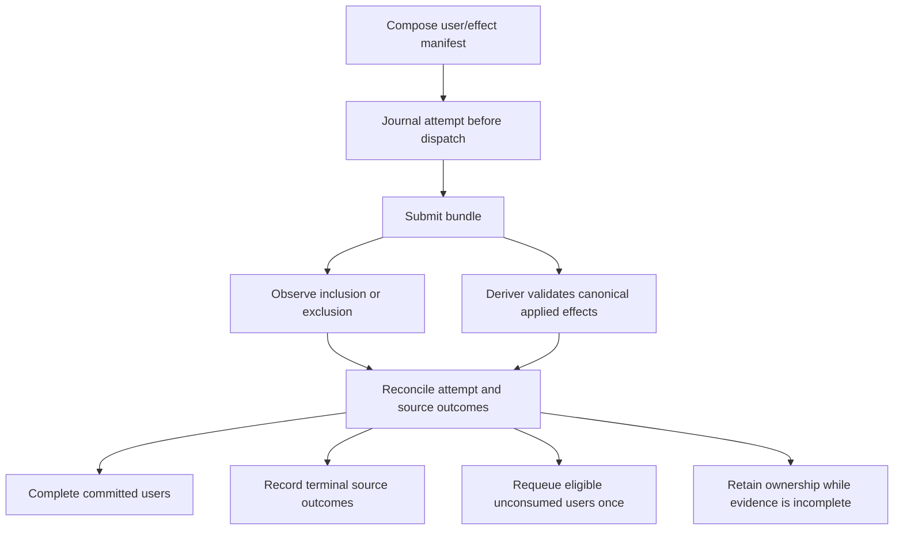

# Partial consumption: upstream findings and implementation plan

**Historical upstream analysis and implementation plan.** The implementation
based on this plan is tracked in [completion.md](completion.md), including the
actual branch/base, validation results and rollout limits. Findings and line
numbers below describe the original audit baseline, before implementation.
The [current scope](default-policy.md) supersedes the durable-journal requirement
in P4 and the opt-in policy in P5: tracking is in memory and partial consumption
is always enabled.

Checked on **2026-09-11 at 20:08 UTC**. Upstream has an open enablement issue and
related fixes, but I found no PR that completes partial consumption end to end.
The fork already contains the original truncation fix and adapted settlement
hardening. Its remaining critical gap is transaction accounting: a confirmed
batch height is currently treated as confirmation of every held transaction.

**Recommendation:** first make reconciliation preserve and classify every
transaction, then enable partial bundles behind an explicit policy. Enabling
`revertingTxHashes` alone would expose a reproduced ledger defect.

## 1. Baseline and upstream evidence

| Item | Revision |
| --- | --- |
| Fork branch | `backport/upstream-2026-09-11` |
| Fork HEAD | `c2e7b647593217876094090f85bc0f7502ef2492` |
| Live upstream main | [`c97b83f142b947243c2d7ef6a76b627d4bfcb71b`](https://github.com/eez-association/eez-rollup0/commit/c97b83f142b947243c2d7ef6a76b627d4bfcb71b) |
| Protocol submodule | `3c0cdf4955941a5c23639346932b55b33babebbd` |

The initial worktree was clean. [upstream-snapshot.json](upstream-snapshot.json)
records issue/PR states, revisions, search scope and validation results.

| Upstream item | Verified status | Relevance |
| --- | --- | --- |
| [Issue #122 — Enable partial consumptions](https://github.com/eez-association/eez-rollup0/issues/122) | Open; created Aug 27; no comments | Exact feature request: permit partial bundle consumption and test deterministic failures. |
| [Issue #77 — Sync Block transactions not properly truncated](https://github.com/eez-association/eez-rollup0/issues/77) | Open; created Aug 6; no comments | Unconsumed outbound user transactions were appended without system loads. Its specific offset defect was fixed in #90 despite the issue remaining open. |
| [Issue #146 — partial settlement can silently drop a held transaction](https://github.com/eez-association/eez-rollup0/issues/146) | Open; created Sep 10; no comments | Remaining observer/deriver race. The same ledger behavior is reproduced here below. |
| [PR #90 — settlement attribution and log scanning](https://github.com/eez-association/eez-rollup0/pull/90) | Merged into main Aug 17 | Positional settlement attribution, resumed slices and original outbound-tail fix. Preserve it. |
| [PR #115 — settlement hardening](https://github.com/eez-association/eez-rollup0/pull/115) | Merged into main Sep 1 | Actual settlement endpoint, resume nonces and safe-head updates across same-block batches. Preserve the fork adaptations. |
| [PR #139 — defer withdrawals until escrow is funded](https://github.com/eez-association/eez-rollup0/pull/139) | Open | Related bounded queue recovery, not a partial-settlement fix. Preserve the fork's existing funding-deferral behavior independently. |
| [PR #141 — explicit L2 ranges](https://github.com/eez-association/eez-rollup0/pull/141) | Merged Sep 8 into `aditya/defer-insufficient-escrow`, not main | Related placement work. Its merged badge does not establish inclusion in main. Do not replace this fork's block-hash/native-DA placement blindly. |
| [PR #152 — spec-compliant DA structures](https://github.com/eez-association/eez-rollup0/pull/152) | Open draft, based on `fix/log-decoding` | Adjacent format work; not a prerequisite for the proposed accounting fix. |

[Issue #131](https://github.com/eez-association/eez-rollup0/issues/131) describes
the shared settlement failure domain. Partial consumption reduces the work a
bad transaction can block; it does not eliminate invalid nonces, prove-time
rejection, or dependencies between later transactions.

Search covered issue/PR text and references to #122/#77/#146, all 15 currently
open PRs, titles/bodies of all open and closed PRs, and the three issue timelines.
No connected implementation PR was returned by those timelines. This describes
the inspected published work, not unpublished development.

### What the merged PRs fixed

#90 records the original outbound count before slicing, pairs resumed entries
at the correct offset, and appends ordinary users only after that original
boundary. The [review discussion](https://github.com/eez-association/eez-rollup0/pull/90#discussion_r3777834160)
and [fix commit](https://github.com/eez-association/eez-rollup0/commit/6e147fa9bd31ddc26791e30fb7ec7064c85d7a09)
agree with the patch.

Both that commit and #90's merge `b4c4ad7` are ancestors of this fork.
The current implementation uses the original **outbound group count**, the
appropriate unit for its grouped signed transactions.

#115 indexes the validated actual endpoint instead of the claimed range end,
carries the replayed terminal hash, and handles same-height resumes. Its merge
`218b7a8` is not an ancestor here; the behavior was ported and adapted, as
recorded in the [backport ledger](../2026-09-11-upstream/completion.md).
Neither PR provides transaction-level optimistic settlement accounting.

## 2. Original audit baseline: supported behavior and gaps

Line numbers refer to the pinned fork HEAD.

| Area | Evidence | Assessment |
| --- | --- | --- |
| Relay request | [submitter.rs](../../../crates/eez-l1/src/submitter.rs), `post_bundle` / `bundle_request`, around 955 | Allowlists are omitted deliberately because partial settlement previously desynchronized the composer. |
| Bundle membership | [composer.rs](../../../crates/eez-composer/src/composer.rs), around 3459 | postBatch followed by inbound L1-signed users. Outbound L2-signed users belong to the L2 block/DA. |
| Attribution | [scan.rs](../../../crates/eez-l1/src/scan.rs), `Settlement`, `settlement_carriers`, `attribute_settlement_with_successes` | Ordered roots are attributed within each batch's window. Successful carriers expand into virtual effects, including committed outcomes whose individual frames reverted. |
| Reconstruction | [deriver.rs](../../../crates/eez-deriver/src/deriver.rs), around 1894–2185 | Tracks original group boundaries, selects applied slices, rejects splitting an outbound user group, and excludes unconsumed outbound users. |
| Commitments | [local/build.rs](../../../crates/eez-composer/src/local/build.rs), `sync_block_hashes_at_positions` | Prefix commitments are independently rebuilt block hashes. A partial block can replace the full block at the same height. |
| Cursor confirmation | [optimistic.rs](../../../crates/eez-composer/src/optimistic.rs), `resolve_below_cursor`, line 161; composer around 1374 | Releases every user reservation below the cursor without examining consumed transactions. Confirmed defect. |
| Recovery recheck | Composer `recover_failed_batch`, around 1667 | Under the reconcile lock, cursor at/above Sync height again releases all users and abandons recovery. A second loss path remains if only the first shortcut is fixed. |
| Observation | Submitter `settlement_in_block`, line 915; composer `observe_bundle_outcome`, line 4945 | Boolean result cannot express partial application; any matching root in the block can satisfy the observer, unlike the scanner's per-batch attribution. |
| Persistence | [l1_canonical_head.rs](../../../crates/eez-l1/src/l1_canonical_head.rs), `BatchRecord`; [correlation.rs](../../../crates/eez-deriver/src/correlation.rs), `BatchCorrelation` | Block provenance lacks user dispositions. Held/optimistic queues are in memory. Correlations cannot restore lost inbound raw transactions. |
| Reorg/finality | Composer around 1180–1275; optimistic `take_rolled_out` / `take_finalized` | Assumes entire rows settled. Old history must not release or recover a transaction owned by a newer retry. |
| Harness | [bundle_rpc.rs](../../../crates/eez-node/src/bundle_rpc.rs); [builder-stub.py](../../../scripts/builder-stub.py) | Dev RPC ignores allowlists; Anvil stub permits one transaction unless passing through to a builder. Neither alone validates partial-builder semantics. |

The [pinned protocol](../../../eez-core-protocol/src/EEZ.sol) already attempts
immediate entries independently and emits `L2TxSkipped` for failures.
Dependent entries then encounter mismatched roots. An outer postBatch revert
still undoes the entire postBatch. Start with an offchain implementation;
weakening contract or proof checks is unnecessary.

### Reproduced ledger defect

Assume a rich Sync block at height H contains U1/U2/U3. L1 commits only U1/U2
and the deriver reconstructs the corresponding prefix block at H.

1. The observer may mark the row failed because the full block hash was not reached.
2. `resolve_below_cursor(H)` returns **U1/U2/U3** for reservation release and marks the row settled.
3. `take_failed_for_recovery(H)` returns nothing and the emission gate opens.
4. U3 remains only in settled history, with no normal path back to the queue.

Reversing observer notification and cursor resolution has the same result.
Recovery completing before derivation is another interleaving to test; making
the observer faster is not a solution.

[reproduce_cursor_loss.py](reproduce_cursor_loss.py) compiles the unchanged
production ledger methods with small stand-ins for external data types and
reproduces both notification orders. It supplies the partial-settlement scenario;
it does not execute L1/EVM or demonstrate a live transaction loss.

## 3. Required semantics

A posted batch, applied L2 effects and completed source transactions are separate
concepts. The implementation must preserve these invariants:

1. Height advancement never proves that all proposed users settled. Evidence
   identifies the rollup, postBatch attempt, canonical L1 block and batch
   position, plus the actual L2 endpoint hash.
2. A signed outbound transaction with its system loads/callbacks is an indivisible
   L2 replay group. Never replay its bare user transaction.
3. Inbound users may contain mutable, static, lookup-only and caught-revert
   actions. They can complete with no L2 root change. A landed source transaction
   that executes only some intended calls still cannot reuse its spent nonce.
4. Expected/caught destination reverts can be valid proven outcomes. Missing
   individual root events do not alone identify failed users.
5. Every accepted user has one active disposition: held, awaiting settlement
   evidence, completed on canonical history, or explicitly terminated with a
   reason. Historical records do not acquire active ownership.
6. Partial recovery preserves the canonical prefix and moves only eligible
   unresolved users. It never substitutes an empty sibling for a confirmed prefix.
7. Duplicate notifications and interrupted-transition retries cause no extra
   queue insertion, reservation release or attempt charge.
8. Reorg invalidation uses L1 identity, including same-L2-height replacements.
   Finality cleanup waits for complete user accounting.
9. Missing receipts, lag and network errors remain inconclusive. They do not
   prove exclusion or nonce reuse.

## 4. Proposed architecture

### A. Capture a user/effect manifest at composition

Add shared types in `eez-protocol`, for example `settlement_manifest.rs`,
and construct the manifest from final survivor compositions and checkpoint
positions. Retain it with the optimistic attempt.

Each user record needs its hash, source direction/chain, sender, nonce, original
FIFO position and attempt count; outbound group/settlement-host mapping or
inbound FIFO action mapping; producing-effect ranges and exact L2 transaction
endpoints, including callbacks; and expected outcomes/call identities.
Represent static/lookup-only users even when they produce no L2 delivery.
Keep carrier indices distinct from virtual effect positions and event counts.

Do not zip `HeldTx` with `Settlement.len`. Outbound-first composition and
inbound FIFO also mean an entry prefix need not be a prefix of the held queue.
A partially completed inbound user needs per-action evidence, not just a
transaction-level consumed count.

Keep this as local attempt metadata initially, with no new DA field. Followers
derive consensus state from authenticated L1/DA inputs. If an essential consensus
boundary is absent from the current format, demonstrate it with a valid fixture
before proposing a versioned format change.

### B. Publish authoritative derivation evidence

Add `ReconciledBatchSettlement` in `eez-l1`, shared by deriver and composer.
Proposed fields:

- Canonical L1 number/hash, transaction hash/index and batch occurrence identity.
- Applied virtual slice and actual endpoint L2 number/hash.
- Validated outbound group and inbound effect selection.
- Reconciliation-complete version/status, including completed same-block scanning.

Keep the height index for scheduling and add lookup by batch/attempt identity.
Publish evidence before exposing cursor confirmation under existing reconcile
synchronization. Readers take a consistent snapshot and recheck canonical
generation before mutating ownership.

A conclusively scanned batch with no applied effects also needs an outcome;
absence of a result must not conflate “nothing applied” and “not scanned.”
Catch-up, live reconciliation and same-height resume share this contract.
Preserve earlier same-block batch evidence even if a later batch extends or
replaces its terminal block.

### C. Classify each source transaction

Intersect the manifest with validated replay selection and canonical source
receipts/nonces. Bind receipt evidence to a checked block hash.

| Disposition | Evidence | Action |
| --- | --- | --- |
| L2 effects committed | Validated groups/effects and canonical L2 execution matching the manifest | Release ownership once; retain reorg/finality history. Also check source disposition for inbound users. |
| L1-only completion | Canonical source receipt and applicable call/consumption evidence | Complete the user even with zero L2 system transactions. |
| Source included with revert or incomplete effects | Canonical L1 receipt and actual outcome | Record terminal outcome; never retry identical signed bytes; preserve already applied effects. |
| Source nonce replaced | Canonical source nonce/receipt evidence | Terminate original explicitly; reevaluate later nonces against actual chain state. |
| Unconsumed and retryable | Absent canonical effects and source nonce still usable | Requeue in original FIFO order; charge existing bounded failure policy once. |
| Inconclusive | Lag, RPC error, ambiguous attribution or unresolved reorg | Retain ownership, retry evidence lookup, keep relevant emission gate closed. |

Existing `ExecutionConsumed` can provide mutable queue evidence using call hash,
queue index and transaction/log provenance. Static-only sources still need
source receipts; validating their exact result may require the existing
execution/observation machinery. Reverted logs do not prove persisted effects.

Outbound source transactions use the reconciled L2 chain. The existing
L1-only `Submitter::receipt_exists` cannot decide their nonce status, and an
optimistic L2 receipt alone cannot prove settlement.

### D. Make ownership transitions idempotent

Replace height-only resolution with explicit completed/retryable/terminal users,
for example `resolve_reconciled(attempt_id, evidence, source_outcomes)`.
Use postBatch identity plus attempt generation for callbacks so a late observer
cannot mutate a replacement at the same height.

An inclusion observation moves the attempt to “awaiting reconciliation.”
Keep full-failure/empty-sibling recovery for conclusively unapplied batches.
For included partial batches, the deriver owns canonical repair; the composer
only reconciles users. Replace both cursor shortcuts identified above.

Extend the held pool's single-lock operations to apply the partition and
ownership transfer. Do not release a reservation and requeue in separate
observable operations. Old finalized history must never release a retried
user's current reservation.

## 5. Ordered implementation

### P0 — add failing behavioral coverage

Files: optimistic/composer tests; proposed
`crates/eez-node-e2e/tests/partial_consumption.rs`; testkit controls.

Construct a valid three-user batch with a middle failure. Use barriers rather
than sleeps to force observer-first, deriver-first and recovery-entered orders.
Pin both cursor shortcuts and a stale observer after same-height replacement.
Include a competing batch that confirms the height but omits local users.

Acceptance: exact user dispositions and confirmed-prefix preservation fail on
current code. The diagnostic is historical defect evidence, not an acceptance
test that should remain green after the fix.

### P1 — introduce and validate the manifest

Files: proposed protocol manifest module; composer final-survivor/checkpoint
construction; optimistic attempt record.

Map users to actual groups/actions and virtual effects; validate complete,
non-overlapping coverage. Preserve FIFO, nested callbacks and zero-effect users.
Prove emitted outbound endpoints are whole-user boundaries.

Acceptance: vectors cover one-to-many effects, grouped outbounds, static/mutable
FIFO, caught reverts and carrier expansion. Reject malformed manifests before
submission.

### P2 — publish evidence and fix transaction loss

Files: `eez-l1/src/l1_canonical_head.rs` and shared result types;
`eez-deriver/src/deriver.rs`; composer `optimistic.rs`, `composer.rs`,
`held_pool.rs`.

Publish exact endpoint/selection evidence and implement ownership partitioning.
Handle zero application, anchor-only settlement, partial terminal blocks,
earlier-range endpoints and same-height resumes. Replace every cursor-only
completion shortcut while retaining evidence-based false-negative protection.

Acceptance: P0 races pass; U1/U2 remain canonical and U3 is retried or explicitly
terminated according to source evidence. Repeated results have no side effects.
No partial confirmed batch is replaced by an empty sibling.

Test these ownership transitions against supplied validated source outcomes;
P3 connects the runtime observer and source lookups. This is the first
independently reviewable accounting change. Keep the relay policy atomic.

### P3 — correct observer and source-outcome handling

Files: `eez-l1/src/submitter.rs`, scanner attribution helpers, composer
observer/recovery.

Replace `state_applied: bool` as final authority. Separate submission not
attempted, submission uncertain, excluded from the valid slot, included/awaiting
reconciliation, and reconciled. Reuse per-batch attribution rather than matching
a root anywhere in an inclusion block.

Make receipt/nonce lookup direction-aware and canonical. An included revert
spends its nonce; omission may not. Successful source transactions that caught
a call failure are also not safely resubmittable.

Preserve existing bounded attempts, FIFO, replacements, funding deferral and
sender/direction isolation. Charge retryable unresolved users once per conclusive
failed episode; completed users and infrastructure-only failures receive no
charge. Cascade eviction only where an unresolved nonce gap actually remains.

Acceptance: same-root competitor events cannot complete users; reorg-straddling
reads remain inconclusive; all disposition cases have deterministic tests.

### P4 — preserve recovery across restart, reorg and finality

Files: proposed `eez-composer/src/settlement_journal.rs`; node datadir/startup
wiring; optimistic reorg/finality handlers; deriver catch-up publication.

Persist active attempts before external dispatch: raw users, manifest, counters,
target, postBatch envelope/identity and ownership. Journal resolution and retry
transfers with replayable operation IDs. Retain data through completion/finality
or explicit termination. Replay must tolerate a crash between journal, deriver
evidence and held-pool updates.

This journal covers submitted attempts and their recovery lifecycle, not all
previously unsubmitted ingress requests. Block-correlation v2 records cannot
replace it or be silently treated as transaction evidence.

After restart, wait for canonical derivation, reconcile journal attempts, and
reconstruct missing evidence even if a correlation checkpoint skips that batch.
Recompose eligible users with fresh proof/DA; never resend an expired postBatch.

Invalidate reorg evidence by L1 identity, including same-height changes. Retain
only settled ownership in old history so newer retries cannot be recovered twice.
Inconclusive finality audits retain journal records rather than dropping them.

Acceptance: crashes at dispatch, evidence publication, transfer and finality
lose/duplicate no user or retry counter. Old reorg/finality callbacks cannot
release a newer attempt's reservations. Partial submission requires a durable
configured journal; upgrading old in-memory attempts requires draining them.

### P5 — add controlled partial submission

Files: submitter request/config, node wiring, CLI/env documentation and testkit
request capture. Proposed policies: `Atomic`, `AllowInboundReverts`, and a
separately supported drop policy.

Keep atomic as the rollout default. In partial mode populate
`revertingTxHashes` with **only actual inbound L1 user hashes in the bundle**.
postBatch remains required and first; outbound L2 hashes do not belong there.
Hash signed envelopes correctly and preserve native blob sidecars.

Do not apply #122's “all hashes” wording to postBatch itself: it installs and
verifies the tables required by the source transactions.

[Flashbots' API](https://docs.flashbots.net/flashbots-auction/advanced/rpc-endpoint)
defines permission to revert. [rbuilder configuration](https://github.com/flashbots/rbuilder/blob/develop/docs/CONFIG.md)
also describes configurable discarding of transaction errors for allowed hashes.
Verify both outcomes against the actual builder image/configuration. Current
Kurtosis files use the moving `ethpandaops/reth-rbuilder:develop` tag; record an
immutable image digest for validation.

Do not send `droppingTxHashes` until the selected builder's behavior is tested.
A standard revert allowlist does not guarantee invalid-nonce omission. Disable
raw-mempool fallback in the partial profile and require a validated builder path.

Acceptance: exact allowlist membership, required postBatch, unchanged timestamp
pins and real prefix inclusion. Unsupported combinations fail clearly.

### P6 — validate end to end and roll out

Files: partial E2E, testkit controls/signals, native-test selection, Kurtosis
scenario driver, README and composer/prover SPEC.

Use real contracts, signer and valid DA. Inject the failure after successful
composition/proving or through controlled valid L1 execution; a compose-time
rejection only tests earlier poison eviction.

Run deterministic integration coverage, the pinned builder/relay Kurtosis case,
then an explicit devnet canary. Record canonical hashes, per-user dispositions,
retries/evictions and continued safe-head progress. Rollback disables new partial
requests but retains reconciliation for attempts already submitted.

Acceptance: the matrix below passes with exact evidence and no unexplained
held-user loss.

Dependency order: **P0 → P1 → P2 → P3 → P4 → P5 → P6**.
P0–P3 deliver the urgent accounting fix. P4/P5 are required before claiming
reliable automatic recovery with partial submission enabled.

## 6. Acceptance matrix

| Scenario | Required assertions |
| --- | --- |
| Full consumption | Every intended user completes once; registry commitment and canonical full block agree. |
| First/middle/last failure | Exact applied effects and endpoint; every user has a disposition; healthy subsequent traffic settles. |
| Anchor only / nothing applied | Correct actual endpoint; no phantom completion or permanently closed gate. |
| Inbound dropped | Retry only with reusable source nonce; preserve FIFO and reservations. |
| Inbound included/reverted | Record failed receipt, never retry identical bytes; spent nonce causes no false gap cascade. |
| Inbound succeeds after caught call failure | Retain actual applied calls and terminate source correctly without replaying executed calls. |
| Nonce replaced/invalid | Verify real builder behavior and original-user disposition; independent senders progress. |
| Outbound entry skipped | Retain committed groups; omit unconsumed users plus loads/callbacks; retry against canonical L2 nonces. |
| Multi-root outbound | Enforce whole-user groups; reject split replay. |
| Multi-action inbound | Per-action evidence covers mutable/static/lookup-only users and zero-root completion. |
| Expected/caught destination revert | Preserve valid proven outcomes and carrier expansion; never decide by event count alone. |
| Mixed directions / same EOA | Isolated source nonce namespaces and preserved FIFO/dependencies. |
| Ordinary Sync-tail users | Never append an unconsumed cross-chain user; check ordinary-tail compatibility with actual prefix commitment if that shape is admitted. |
| Observer/deriver/recovery order | Identical dispositions; no prefix rollback, duplicate queue ownership or double attempt charge. |
| Stale observer after replacement | No mutation of the new attempt at the same height. |
| Same-block batches / mid-chain resume | Exact attribution windows, emitted system nonces, no duplicate prefix, final safe hash correct. |
| Competing batch at same height | Omitted local users are not completed; actually included users are not retried. |
| Duplicate events / lag / RPC failures | Idempotence and retained ownership under uncertainty. |
| Partial then reorg / same-height replacement | Invalidate canonical evidence; recover genuinely unresolved users once. |
| Restart at ownership boundaries | Durable replay without loss, duplication or counter reset. |
| Native blob + clean follower | Real blob/proof path; follower derives exact partial block hash from L1 alone. |

The existing
[`resumed_batch_settles_only_its_new_suffix`](../../../crates/eez-node-e2e/tests/resumption.rs)
is not positive proof of valid partial replay. The
[backport ledger](../2026-09-11-upstream/completion.md) documents that its extra
synthetic entries lack valid sidecars, so it expects rejection then recovery.
Add a positive valid-sidecar fixture while retaining this negative case.

## 7. Verification performed during the original analysis

- `cargo test --offline --locked -p eez-composer --lib optimistic::tests -- --nocapture`: **8 passed**.
- `cargo test --offline --locked -p eez-l1 -p eez-deriver --lib partial`: **2 passed**.
- `python3 docs/audits/2026-09-11-partial-consumption/reproduce_cursor_loss.py`: current production ledger defect reproduced in both notification orders.
- Checked #90 ancestry and #90/#115 patches; traced submission, scanning,
  derivation, ledger, receipt recovery and finality paths.
- No application changes, deployments, upstream comments or PRs were made.
  No live partial-bundle E2E was run.

The passing tests validate existing pieces while leaving transaction-level
reconciliation uncovered. Completion requires the behaviors above, not just
the relay-request change.
