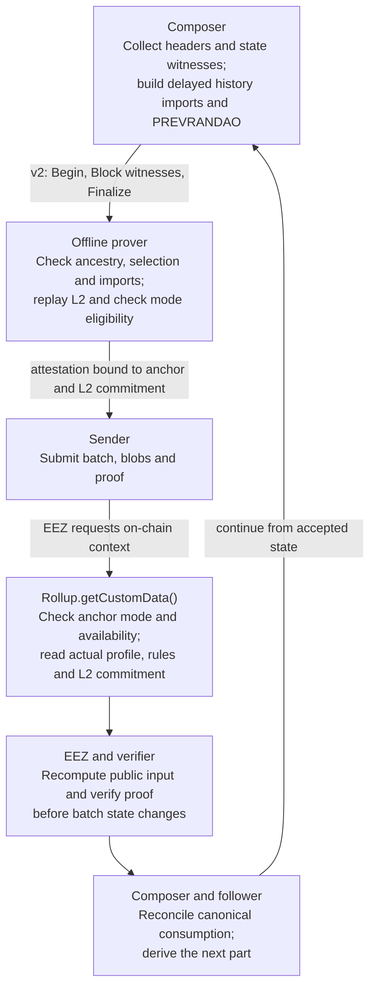

# L1 history, synchronized PREVRANDAO and offline proving

| Field | Value |
| --- | --- |
| Design status | Baseline implemented and locally validated at `d2f3d7c5`. Continuous L2 production during L1 delivery failures is an additional accepted requirement (2026-10-23); the proposed revision below is not implemented. The baseline is not ready to merge against that requirement. |
| Date | 2026-10-22 |
| Source baseline | Latest `origin/main` at `a50c326d99f7cd1c21406eedbf370a344015a6b5`, with the required unmerged v2 streaming backport `00fe7bc2541a56f26f088d0a7baf567dac5059de` integrated by merge `8621b0368f4f42dc871dd84c0aaf5b6c4599bfbd`. |
| Protocol pin | Published `feature/e2e_edge_cases` at `84a5b5207880f192a6a5896cbfe0bac5249db47f`, without local protocol changes. RollupX owns the history predeploy and offline manager. |
| Design input | [Protocol feedback](https://hackmd.io/@Yu7RfKfWRP6MwaKqIFALjw/HygKZD8hMg), reviewed 2026-10-21 |
| Existing contracts | [Core public inputs](../../eez-core-protocol/docs/MULTI_PROVER_SPEC.md), [streaming RPC v2](../../crates/eez-control-rpc/STREAMING_SPEC.md), [fork timing and eligibility](../../crates/eez-protocol/src/l2/derivation.rs) |

## Required revision: production independent of L1 delivery

Status: the user requires uninterrupted L2 block production during missed L1
slots or delayed/unavailable L1 delivery. That requirement is accepted. The
following protocol revision is a proposed implementation, not shipped behavior.
[The investigation](../audits/2026-10-23-l2-continuity/README.md) records the exact
baseline and production gates. The remaining sections describe the implemented
baseline; their latest-source and pause rules must be revised together before
this branch can satisfy the new requirement.

### Observable contract and necessary tradeoff

A running, bootstrapped sequencer with available local execution/storage resources
continues the configured L2 clock and ordinary local execution without waiting
for a new L1 head, an L1 RPC, a prover response, settlement, or a particular number
of unsettled blocks. Work requiring new L1 effects or a live cross-chain context
remains owned and pending. Canonical settlement/finality still requires L1;
a local block or receipt must not be reported as accepted there.

No fixed delay can establish that an unseen L1 block does not exist. Before new
information arrives, an actually empty slot and a produced-but-delayed block are
indistinguishable to the sequencer. Continuous production therefore replaces
mandatory latest-at-cutoff selection with an explicitly recorded, monotone origin.
The selected origin can remain old. The prover must still authenticate every
selected hash; it no longer proves a claim about the producer's receipt time or
that every eligible canonical header was already available.

This permits a producer to postpone origin advancement, including PREVRANDAO
changes. Maximum freshness cannot be a block-validity condition during an
unbounded L1 outage. Expose origin age/backlog operationally; do not describe this
as unpredictable randomness, finality, or guaranteed prompt import by a malicious
producer. True L1 reorg recovery and conditional cross-chain replacement remain.

### Deterministic origin recorded in existing public metadata

Proposed minimal encoding for this new-network profile:

- Reserve the entire L2 header `extraData` for exactly eight bytes: the selected
  L1 execution block number as unsigned big-endian u64. Genesis records its
  configured bootstrap number. No omitted/default/alternate encoding is accepted.
- Every block carries that number, including repeats and Sync variants.
  [V0 operations already publish extraData](../../crates/eez-driver/src/derivation/encoding.rs);
  their canonical metadata runs compress repeats without changing the codec.
  The number is also bound by the L2 block hash carried into settlement.
- Headers/witnesses resolve the number to its exact hash and PREVRANDAO.
  The inherited state endpoint must match the header chain. A number alone
  never authenticates a header.
- Keep the existing update positions `U(T)`. At other positions the number must
  equal the parent's. At an update, it may remain equal or advance through at
  most 64 consecutive produced L1 blocks. The selected header must satisfy
  `timestamp(source) <= T`. No global latest-source/successor test applies.
- At every update position execute the existing system call, including an empty
  import when the origin repeats. Empty imports advance the scheduled cutoff,
  preserve the endpoint and use the same PREVRANDAO. Advance imports every hash
  in `oldEndpoint + 1 .. selected`; missing intermediates invalidate the block.
- Keep the selected origin and PREVRANDAO synchronized in storage, the L2 header
  and the actual EVM environment. Parent state/header authentication and full
  replay remain mandatory. Inherited origin data is available locally; a repeat
  must not consult L1 or require a newly resolved cutoff.
- A malformed advertised advance is invalid. A verifier must never replace it
  with a repeat, choose a different origin, shift its execution position, or
  repair missing evidence with RPC.

The producer policy can choose the newest eligible header in its prepared,
linked snapshot, capped to the import limit. If no valid advance is prepared,
it deliberately records a repeat as a valid block input. The public sequence of
choices, rather than different nodes' network arrival times, determines replay.

This uses the existing `Block.rlp`, `ExecutionWitness.l1_headers_rlp` and public
operations metadata. No new gRPC version, protobuf field, outer native-blob
message, or raw-hash import list in DA is needed. Existing configurable/free-form
extraData is superseded for this fresh-network profile. All producers and
consumers must apply the same exact encoding; do not ship a mixed interpretation.

### Delay, late arrival and recovery

The existing delay becomes the minimum age/earliest update opportunity.
For a 12-second interval and 6-second offset:

| Wall time / L2 timestamp | Available evidence and recorded result |
| --- | --- |
| 0 | H100 is the installed origin. |
| 12 | No new header is available locally. |
| 18 | Required update executes an empty import; record H100 and its PREVRANDAO. Local transactions continue. |
| 21 | H101, timestamp 12, arrives and is prepared off the execution path. Already produced blocks remain unchanged. |
| 30 | Next scheduled update may install H101 (or a newer eligible linked endpoint within the import budget); both values change together. |

If the slot at 12 was actually empty, the same repeated choice remains valid.
When several headers arrive, retain their exact consecutive chain and import in
bounded updates. Do not rewrite past selections merely because a newer eligible
header arrived late. Actual canonical reorgs can invalidate previously imported
history, and cross-chain proposals still have their original exact-target rules;
this revision is not a promise of immutable unsettled L2 receipts.

### Production clock and settlement must have separate ownership

Changing source selection alone does not satisfy the requirement:

1. Drive ordinary production from the immutable L2 grid and local head, including
   ordinary Sync boundaries. Bootstrap the clock from local genesis/state; it
   cannot require the first live L1 notification or stop when the watcher closes.
2. L1 notifications schedule acquisition and settlement opportunities. Reconnection
   and RPC preparation run in bounded owned tasks; they cannot hold a production
   lock or make the clock await remote responses.
3. The existing four additional same-parent replacements bound proving/submission
   work only. Preserve that bound, old attempt identities and queue ownership.
   Exhaustion must stop those attempts while ordinary block production continues.
4. The current global speculative-depth gate cannot halt ordinary production.
   Bound cross-chain speculation, concurrent work and memory separately. Retain
   produced blocks and reconstruction inputs on disk; proof quotas and slow
   prevalidation must not require retaining an unlimited RAM session.
5. If a live cross-chain proposal is not ready at the relevant deadline, seal an
   ordinary block and keep the requests pending. Preserve whole groups, nonce
   dependencies and typed failure accounting. Never fabricate an L1 observation,
   mark uncertainty as successful execution, or evict work because L1 is unavailable.
6. Reconcile settlement independently. A returning L1 head must not pull the local
   production target backward. Existing accepted-prefix/partial-consumption rules
   and real reorg handling remain authoritative.

Local production is distinct from the L1-derived safe head: a follower that only
consumes published L1 data cannot advance that safe head during an L1 publication
outage. Restart still has the repository's volatile request-queue limits; this
proposal adds no durable queue guarantee. Disk exhaustion and local execution
failure are not solved by changing the L1-origin rule.

### Prover and on-chain boundary

The stateless prover checks the recorded selections, canonical header encodings,
contiguous imports, delay eligibility, execution, DA, public inputs and mode
binding. Finalize must retain complete applicable ancestry authentication against
the on-chain anchor and accepted parent; agreeing on a recorded number is not
authorization to sign. Missing proof evidence rejects the proof without blocking
the independent production clock.

Keep both anchor modes and the absence of signer L1/L2 RPC. `getCustomData` still
binds the actual accepted L2 commitment, deployment/profile, active rules and
actual-parent or historical anchor. Historical mode stays ordinary-only and its
terminal-time/age checks remain; freshness/maximality checks tied to the old
selection rule must be reviewed explicitly, never bypassed.

Revise the committed execution-profile semantics and validation specification
version atomically, with regenerated genesis and affected fixtures. Keep identity
schema 6 and wire v2. This is a fresh-network protocol revision, not a runtime
configuration toggle or an existing-network upgrade. The core's opaque operations
and manager interface appear sufficient; confirm this through integration tests
before claiming that no dependency change is required.

Bounded settlement parts remain required after recovery. The existing 131,072
header/aggregate witness limits still constrain a complete old-to-recent bridge;
splitting only L2 blocks does not remove that constraint. Continuous production
must not depend on enlarging these limits. Recovery beyond them needs an explicit
bounded ancestry-authentication design and validation; this proposal does not
claim arbitrary-duration recovery or permission to truncate evidence.

### Acceptance before implementation can be declared complete

| ID | Required evidence |
| --- | --- |
| L1 | Produce and execute local transactions through one and multiple missed slots, beyond four replacement opportunities and beyond the previous 64-block depth cap. Assert cadence/progress, not only eventual catch-up. |
| L2 | Withhold L1 headers at an update, deliver a timestamp-eligible header at 9 seconds and after a whole interval, and prove old L2 block hashes/receipts are unchanged by late delivery alone. |
| L3 | Close/stall the L1 watcher and RPC, and stall the prover/settlement worker. Ordinary production continues; bounded workers shut down and retries retain ownership. |
| L4 | Every block type, including an empty or ordinary Sync, repeats or advances the exact encoded origin; actual PREVRANDAO, history state, receipts and roots agree. |
| L5 | Reject short/long metadata, decreasing origins, off-schedule advances, too-new sources, jumps over 64 records, omitted/conflicting headers, altered PREVRANDAO and malformed updates without fallback normalization. |
| L6 | Replay the same public operations with different local header-delivery timing and a cold network-denied signer. Composer/prover/follower reproduce identical block hashes for both anchor modes. |
| L7 | Resume settlement in bounded parts after a delivery outage. Preserve pending whole cross-chain groups, original attempts, partial consumption and accepted-root continuity; do not imply finality from local production. |
| L8 | A real L1 reorg still invalidates incompatible origins/proofs. A merely delayed canonical descendant does not rewrite recorded historical selections. |
| L9 | Check genesis/profile identity, new metadata admission, old-profile rejection, wire-v2 conformance, production feature selection and all affected process/contract suites. |
| L10 | Exercise the retained-evidence bound and document the supported recovery envelope. A proof-limit error cannot freeze production or silently drop a bridge. |

Implementation must update the shared origin/history rules, EVM hook, producer
metadata, public replay, witness capture, streaming signer, scheduler,
settlement/queue integration and owning specs together. The old latest-at-cutoff
tests must become explicit baseline evidence and be replaced by the new
selection guarantees, not simply deleted to make validation pass.

## Implemented baseline

The following design and its existing O1–O15 evidence describe `d2f3d7c5`.
They do not demonstrate the continuous-production acceptance criteria above.

## Scope

This design is exclusively for newly created networks, active in full from
genesis. Existing deployments, datadirs and operator resources are outside
scope. There is no hardfork activation switch, migration, legacy seed path,
RPC-backed prover fallback, v1 proving service or parallel compatibility
profile. Both anchor modes are current supported modes. Preserve shared
infrastructure with a current consumer, new-network genesis replay, reorgs,
restarts, retries, partial consumption and fork-aware historical L1 decoding.
Reject incompatible configurations and peers explicitly.

The [offline manager](../../contracts/src/OfflineRollup.sol) implements the
pinned `IRollupContract` interface. It preserves the reference manager's owner,
proof-system membership, verification-key, threshold and root-escape policy,
while requiring the offline profile at initialization. The generic core manager
is not the RollupX deployment target. The [history predeploy contract](../../contracts/L1_HISTORY_SPEC.md)
and its tests live in this repository; no unpublished core patch is required.

## Purpose and full flow

Make L1 history available to L2 applications and prove its use without an L1
or L2 RPC connection in the prover:

- Keep every produced L1 block hash from a configured starting block through
  the selected source in an L2 contract.
- At a fixed delayed update, select the latest L1 header at or before the
  cutoff. Use its hash as the current origin and its `prevRandao` for L2
  execution. Hold both until the next update.
- Derive imports from L1 headers and authenticated L2 state. Do not duplicate
  those derived calls or hash lists in settlement blobs.
- Keep `prove.v2.Prover.ProveStream`. Carry raw L1 headers in a typed extension
  of its existing execution witness.
- Authenticate those headers through either the actual settlement parent or
  a specified recent L1 block. Historical mode admits ordinary catch-up;
  cross-chain execution retains an exact inclusion target.
- Settle a long backlog in bounded parts, each with complete evidence and
  an authenticated L2 predecessor.



| Component | What it checks |
| --- | --- |
| Offline prover | Exact headers and ancestry, latest eligible source, every history import, actual EVM PREVRANDAO, complete L2 replay, parent/checkpoints, mode eligibility, effects, blobs and independently computed public input. |
| `getCustomData()` | Initialized deployment/profile; supported selector; actual parent or available historical hash; current L1 rule set and accepted L2 block-hash commitment. Actual-parent mode also binds the actual inclusion timestamp. |
| EEZ and verifier | Rebuild the public input with that on-chain context and verify before replacing queues or executing the batch. Existing root and effect checks still govern consumption. |

The manager does not parse historical headers, replay L2 or populate the L2
contract. The prover supplies an attestation, not a remote storage write.
The current ECDSA backend still trusts its authorized signer to perform all
checks; a ZK backend must prove the same relationships. Neither mode nor the
delay establishes L1 finality.

## Requirements and acceptance

| ID | Required behavior | Acceptance evidence |
| --- | --- | --- |
| O1 | Store every actual L1 hash in the covered range; select the endpoint before applications at each scheduled update. | Historical and current reads, intermediate blocks never selected, repeat selections and absent-history queries. |
| O2 | Only the protocol performs the exact scheduled import; execution failure invalidates the block. | Unauthorized, missing, duplicate, misplaced, reverting and over-budget imports reject; nonce/gas/receipt and rollback checks. |
| O3 | All imported hashes and selected sources belong to one checked chain ending at the chosen on-chain anchor. | Malformed, omitted, reordered, conflicting, non-maximal and unrelated evidence rejects. |
| O4 | Bind deployment, profile, active L1 rules, mode, anchor and accepted L2 commitment into the public input. | Independent Solidity/Rust vectors and individual field-substitution rejection. |
| O5 | Authenticate the L2 parent or a fully replayed permitted whole-group checkpoint; preserve partial consumption. | Parent/checkpoint cases pass; equal-height substitutes, partial groups and invented acceptance claims fail. |
| O6 | No L1/L2 RPC, persistent header database or hidden cache is required by the prover. | Cold process with chain access denied succeeds on complete evidence and fails on missing evidence. |
| O7 | Composer, prover and follower derive identical imports and execution from public reconstruction inputs. | Independent call-byte, header, state-root and block-hash comparisons without per-import blob records. |
| O8 | Bound parsing, imports, witnesses, retained sessions and workers; preserve cancellation ownership. | Resource boundaries, malformed input, timeouts, rewind, restart and controlled concurrency tests. |
| O9 | Retain v2 service/flow with an explicitly gated typed L1 witness extension. | Profile mismatch and missing evidence reject; existing L2 witness fields keep their meaning. |
| O10 | Reorgs, expired anchors and changed accepted roots cannot authorize stale progress. | Reorg of selected or merely imported history, expiry, replacement and inter-part reconciliation tests. |
| O11 | The fixed update offset absorbs delivery latency without arrival time or confirmation depth entering consensus. | Offset zero/intermediate/last, delayed delivery, missed slots, bootstrap and mid-window replay. |
| O12 | Current origin and L2 PREVRANDAO use the same selected header and change together. | Header and actual opcode observations agree across update windows, repeats and catch-up parts. |
| O13 | A backlog whose sources are outside L1's blockhash window settles in admitted continuous parts, each carrying its complete required ancestry bridge. | Expired-source fixtures, cold prover per part, unused-header tampering, canonical consumption and independent final replay. |
| O14 | Actual-parent mode admits live work or ordinary catch-up; historical mode admits only ordinary catch-up with explicit age/time/rule checks. | Both modes, late live rejection, historical reuse, ages 1/256/257, early anchors and L1 rule transitions. |
| O15 | Ordinary L2 contracts may authenticate L1 storage reads against imported hashes. | Exact block/address/slot binding, valid values and absence proofs; malformed or incomplete proofs reject. |

## 1. One schedule for history, origin and PREVRANDAO

The committed network profile defines:

```text
T0       = Sync schedule alignment
delta    = L2 block period
k        = L2 positions per Sync interval
I        = delta * k
q        = update offset, 0 <= q < k

T(n)     = T0 + n * I
selected = latest canonical L1 execution header with timestamp <= T(n)
U(T)     = T + (q + 1) * delta

At U(T), before applications:
  import all new L1 block hashes through selected
  current origin = (selected.number, hash(selected))
  L2 header.mixHash and EVM PREVRANDAO = selected.prevRandao

Retain that source for U(T) <= L2 timestamp < U(T + I).
```

All arithmetic and phase checks are explicit and checked. The same rule
applies to live execution, catch-up and replay. A later settlement anchor
does not move a historical cutoff or replace its source with today's header.

For `delta = 2 seconds`, `k = 6`, `q = 2`, a cutoff at 12:00:00 updates
both values at 12:00:06; the next cutoff at 12:00:12 updates them at 12:00:18.
If H100 and H101 have those cutoff timestamps:

| Illustrative L2 positions | Current origin | PREVRANDAO source |
| --- | --- | --- |
| 1001–1002 | H99, inherited from the preceding window | L1 block 99 |
| 1003–1008 | H100 | L1 block 100 |
| 1009–1014 | H101 | L1 block 101 |

These numbers illustrate positions after an already built boundary, not
the fork's modulo-based Sync numbering. Both values remain fixed across the
intervening Sync boundary. The engine configures PREVRANDAO; writing a
contract's storage cannot change the opcode environment. Replay must compare
both the L2 header field and what transactions actually observe.

The offset gives four additional seconds over `q = 0` in this example.
Construction may begin before the nominal block timestamp, so choose the
offset using measured delivery and preparation latency, including production
lead time. It is a fixed protocol parameter, not a per-request setting.
It adds no FCR, finality or confirmation-depth condition. The reused public
seed is not a guarantee of unpredictable application randomness.

A missed L1 slot adds no block number or synthetic zero record. A repeated
source is valid and still advances the scheduled cutoff. Missing local data
does not prove a missed slot: wait/retry if the correct source cannot be
determined. Never update early on arrival, shift U(T), or retain a stale
source past a required update because acquisition timed out. The ancestry
and maximality rules in section 4 distinguish an actual gap from omission.

An already submitted actual-parent attempt has a narrower speculative recovery
path. After its observation deadline, the Composer may authorize the existing
bounded next-slot replacement on the same reconciled L1 parent. Execution may
then provisionally repeat that endpoint for cutoffs strictly before the new
target, using the actual-parent exception in section 4. It is not evidence of a
missed slot or canonical completion. A different L1 head revokes the permission
and rechecks the unsafe suffix, including when a delayed original arrives.
The original submission remains owned and the shared four-replacement bound
still applies. Ordinary acquisition failures do not enable this exception.

## 2. L2 history contract and deterministic import

`L1BlockhashContract` retains `L1 number -> L1 hash` from an explicit starting
block through the current endpoint. It is not an overwriting ring buffer.
Every produced block in that range is included, even if several new blocks
arrive between updates and only the last is selected. The endpoint is also
the current selection; implementation need not duplicate that state.

Read interface:

```solidity
interface IL1BlockhashContract {
    error L1BlockNotImported(uint64 number);

    function getL1BlockHash(uint64 number) external view returns (bytes32);
    function current() external view returns (uint64 number, bytes32 hash);
}
```

Queries outside the imported range revert explicitly. No historical timestamps,
RANDAO values, state roots or full headers are stored. A caller needing those
fields supplies the raw header and checks its hash and decoding. Storing a
hash preserves a commitment, not the ability to recover its preimage.

### Import execution

Use a mandatory pre-execution system call from the existing system address,
`0xeeeeeeeeeeeeeeeeeeeeeeeeeeeeeeeeeeee0076`. Reserve a separate history-contract
address `0xeeeeeeeeeeeeeeeeeeeeeeeeeeeeeeeeeeee0077`; the existing EIP-2935
predeploy continues to serve L2 block history.

At U(T), derive the call from authenticated parent state and checked headers:

```text
oldEndpoint = endpoint in the parent L2 state
selected    = latest authenticated header with timestamp <= T
newHashes   = hash of each consecutive block oldEndpoint + 1 ... selected.number
callData    = canonical ABI encoding of importHistory(T, newHashes)
```

The setter is `importHistory(uint64 cutoff, bytes32[] hashes)`.
Array length determines the new endpoint with checked arithmetic. The shared
engine checks that it is exactly the selected header; a transported cached
call must byte-match the derived call. The contract checks the system caller,
initialization, expected next cutoff, `block.timestamp == U(cutoff)`, nonzero
hashes, bounds and append-only numbering. Empty imports retain the endpoint
and still advance the cutoff. It never overwrites conflicting historical data.

Configure the selected header's PREVRANDAO for the block, perform the existing
L2 parent-hash-history update and protocol-balance cleanup, then execute the
history call before applications and authorized native actions. All terminal
variants include this transition, also when `q = k - 1` places it at Sync.
At other positions, retain the source and perform no history import.

The call has no transaction index, receipt, fee, sender nonce increment or
contribution to transaction gas accounting. Its separate execution budget and
maximum import size are committed in the profile. Preserve the system account's
nonce and balance; emit no logs or external calls. Missing/wrong code, unexpected
output, revert or budget exhaustion invalidates the block and discards its
uncommitted changes. Native `0x76` admission remains restricted to EEZL2;
ordinary transactions cannot inject this hook.

This implementation fixes the import limit at 64 consecutive headers and the
separate execution budget at 2,000,000 gas. The runtime has mapping slot 0 and
full-width scalar slots 1–6 for starting number, endpoint, next cutoff, interval,
delay and import limit. The existing genesis generator produces one canonical
runtime plus its Rust bytes and Solidity code-hash binding; source-path metadata
must not create competing runtime identities.

Access control alone does not authenticate L1. The contract cannot check L1
ancestry using L2 `blockhash`; the shared execution checks and settlement
proof establish that relationship.

A direct engine write could implement the same transition, but would move
layout and update checks into every execution backend. The system call keeps
those checks in shared EVM execution. Changing to direct writes would require
a coordinated profile revision and independent state-transition vectors.
No full system transaction is needed solely for these imports.

### Bootstrap and bounds

Genesis fixes the history starting number/hash, initial
consecutive records, selected endpoint, last installed cutoff and next update.
The initial selection covers the window before U(T0), including the first
`q` positions. For a regular initial window it is selected at `T0 - I`;
reject underflow. There is no activation bootstrap or migration path.

The bootstrap contents are committed by the profile and initial L2 block
hash. Their headers and ancestry must be checked against the first proof's
anchor. Do not trust a Composer-selected initial endpoint. History from L1
genesis is available only if that entire range was actually initialized.

Fresh genesis starts history at the selected bootstrap header itself and
initializes exactly that record. `config.rollupX.historyUpdateOffset` is required;
there is no default for an old configuration. The generated account has nonce 1,
zero balance and the exact fixed runtime/storage. Deployment must authenticate
the bootstrap header as the maximal source at `T0 - I` before registration.

Permanent history grows L2 state and reconstruction costs. A scheduled import
must fit its own bound; if it does not, stop production. Neither splitting
proof requests nor catching up later permits skipping records or spreading
one required import over unscheduled L2 blocks.

### RPC simulation boundary

Reads at `latest` or an explicit executed block use that block's state and
header. An executed pending payload also supplies its own state and header.
The pinned Reth fallback for an absent pending payload instead combines the
next environment with its parent's state. That fallback must reject a scheduled
history-update position, even when the selected L1 source repeats: the required
import has not executed. It must not expose new PREVRANDAO with old history.

Derived pending requests therefore require complete canonical evidence and a
position with no scheduled import. At an update boundary, wait for an executed
block or request an already executed block explicitly. This restriction also
applies to local pending-block construction through the shared fallback. It
does not relax block production, replay or proof validation. Tests inspecting
post-transaction state must select an executed block explicitly, rather than
rely on a client's implicit `pending` default.

L2 signed-transaction ingress classifies against the executed head, matching
the local gas classifier. A scheduled pending import therefore cannot cause
an ordinary transaction to be held and later evicted as cross-chain work.
Classification still detects nested/caught dispatcher calls and fails closed
on unavailable traces. It does not reserve future state; final execution and
cross-chain admission remain authoritative. L1 ingress retains pending-state
classification.

## 3. Both anchor modes and their execution rules

Let N and S be the actual inclusion block's L1 number and timestamp; E is the
replayed candidate's terminal L2 timestamp. Candidate ranges still begin and
end at valid Sync boundaries.

| Rule | Actual parent — mode 1 | Historical anchor — mode 2 |
| --- | --- | --- |
| Existing `batch.blockNumber` selector | `type(uint64).max` | Explicit B, with `0 < B < type(uint64).max` |
| On-chain anchor | Number N - 1 and `blockhash(N - 1)` | Number B and `blockhash(B)` |
| Inclusion binding | Exact S, parent number and parent hash | Same B/hash, accepted L2 commitment, profile and active L1 rules; no exact inclusion timestamp |
| Execution eligibility | E == S: live; E < S: ordinary catch-up; E > S: reject | E <= timestamp(B), and timestamp(B) > every relevant source cutoff |
| Cross-chain actions | Allowed only for live candidates under the existing action profile | Rejected, including static, failed, nested and reverted observations that emit no L2 transaction |
| On-chain age gate | Actual parent must be available | B < N, N - B <= 256, nonzero hash |
| v2 `posting_context` | Required, retaining its existing exact target/parent meanings | Must be absent; derive B from calldata and its hash/timestamp from the witness |

Actual-parent mode is the default for a bundle intended for one inclusion
block. The selector does not reserve inclusion: a different parent or timestamp
makes its proof fail. A late live batch cannot become catch-up merely because
its signature is valid for some earlier chain.
Validate target and candidate coordinates against the configured L1/L2
schedules; the target must be a valid L1 slot after the supplied parent.

Historical mode allows later inclusion of an ordinary catch-up batch without
re-proving solely because N advances. The prover checks E <= timestamp(B).
On the configured L1, descendant timestamps increase strictly; the on-chain
B < N check therefore establishes E < S without signing a changing S.
The additional cutoff bound guarantees a checked successor after every
selection cutoff. An early anchor is invalid even when its hash is available.
Requiring B to be at or after the L2 endpoint deliberately avoids a new
on-chain earliest-inclusion-time argument.

This preserves the fork's catch-up prohibition on cross-chain actions.
A valid historical batch has only the ordinary catch-up settlement structure,
with no cross-chain effects or lookup evidence. L2 contracts verifying
historical storage proofs are ordinary local execution and remain allowed.
Supporting later inclusion of live cross-chain work would require a separate
eligibility design; neither anchor authentication nor this proposal enables it.

For B = 100, the age gate permits N = 101 through 356; N = 357 rejects.
These are produced blocks, not elapsed slots. The
[BLOCKHASH window](https://docs.soliditylang.org/en/latest/units-and-global-variables.html#block-and-transaction-properties)
limits anchor age, not the age of the history connected to it. A four-day-old
source can be proven through a recent B. No headers after B are required in
historical mode: L1 resolves B on its actual branch and the timestamp rules
make later blocks irrelevant to source selection.

### What getCustomData returns

Both modes use a new context domain and a fixed ABI encoding. The ordered
common prefix is:

| Field | Solidity type | On-chain source |
| --- | --- | --- |
| domain | bytes32 | `keccak256(bytes("EEZ_ROLLUPX_L1_HISTORY_V1"))` |
| l1ChainId | uint256 | `block.chainid` |
| registry | address | Configured EEZ registry |
| manager | address | `address(this)`, including the proxy address |
| rollupId | uint64 | Registered rollup ID |
| l2ChainId | uint256 | Configured L2 identity |
| protocolConfigHash | bytes32 | Frozen profile commitment |
| l1RulesId | bytes32 | Active L1 rule set at S, from the committed activation schedule |
| currentL2Root | bytes32 | This rollup's actual registry block-hash commitment |

Append the following typed fields and encode the whole flat tuple with
Solidity `abi.encode`, not a nested byte string or packed encoding:

| Mode | Appended fields in order |
| --- | --- |
| Actual parent | `uint8(1), uint64(N - 1), bytes32(blockhash(N - 1)), uint64(S)` |
| Historical | `uint8(2), uint64(B), bytes32(blockhash(B))` |

Zero/no-context mode is rejected. Check all arithmetic/conversions, nonzero
available hashes, configured mode support and initialized identities. The
historical branch enforces the age gate explicitly. Read the current root
through the declared registry getter, not guessed storage slots.
`getCustomData()` remains read-only; it stores no L1 header history.

`protocolConfigHash` commits to genesis/bootstrap, schedule and offset,
history address/code/layout/ABI/budget, coupled selection, header codecs,
derivation, allowed modes and the L1 rules schedule. Publish its canonical
preimage and independent encoding vectors. It is not an arbitrary operator label.

`l1RulesId` prevents flexible inclusion from bypassing a timestamp-based L1
rules change, such as a blob-limit change. Actual-parent validation derives it
at the target S; historical validation derives it at authenticated timestamp(B).
The prover applies that rule set to fork-dependent settlement validation,
including blob limits.
The manager supplies the rule ID active at actual inclusion. A mismatch rejects
before execution; select a new anchor in the new rule period and re-prove.
The committed schedule must cover every proof-relevant L1 rule transition.
Composer chooses historical mode only when its anchor and intended inclusion
are in the same rule period. At a known transition it chooses actual-parent
mode before proving, so ordinary catch-up uses the inclusion block's rules.
This is initial mode selection, not reinterpretation of a failed proof.
The fixed profile must cover all supported transitions. Reject an unsupported
rule period; adding a future transition requires separately specified protocol
work, not a guessed admission limit or an automatic compatibility path.

EEZ obtains actual context from the manager and binds it through its
[pinned public-input construction](../../eez-core-protocol/docs/MULTI_PROVER_SPEC.md#per-ps-publicinputshash-two-stage).
The prover independently recomputes those bytes and the full public input.
The outer digest and settlement ABI stay unchanged; manager and prover
encoders change together. Mode binding prevents a B/max selector swap.

Historical reuse additionally requires the same expected L2 commitment,
settlement data and proof policy. A reorg changing B, age expiry, rule/profile
change or root advancement invalidates the old proof. Never silently switch
modes after a missed live target. Existing dispatch, queue and replacement
rules still apply; verifying a proof is not canonical consumption.

## 4. Complete evidence and offline validation

For each request, supply canonical raw L1 execution headers from the earliest
required source/previous history endpoint through the declared anchor.
Exact-decode with the configured network/fork codec, require decode/re-encode
equality, compute hashes locally, and check:

```text
next.number     == previous.number + 1
next.parentHash == hash(previous)
next.timestamp  > previous.timestamp
```

Reject gaps, reordered/duplicate headers, trailing bytes, overflow and
unsupported fork fields. The chain must include the parent state's stored
endpoint with the same computed hash as its stored value, any inherited source
and every intermediate header through the anchor. Do not omit a header because it was never selected or imported.
Bridge headers authenticate ancestry; they do not advance the L2 import
endpoint past its cutoff. The prover does not execute their L1 transactions
or independently verify L1 consensus.

For each cutoff, select the last header with timestamp <= T. Its immediate
linked successor must have timestamp > T. Only actual-parent mode allows an
endpoint exception: the selected header may itself be the final anchor, if
the bound inclusion timestamp is > T. That endpoint is the last produced
block before inclusion. Historical mode always requires a later timestamp
within the supplied chain and never uses that exception.

For actual-parent mode the last header must match both posting-context
parent fields and precede the target timestamp. Historical mode ends exactly
at B; its decoded timestamp supplies the time checks in section 3. There is
no unlinked list of claimed historical hashes.

The offline validation pipeline is:

1. Bind the exact L2 parent header, hash, number and state root to the selected
   range: use the Begin anchor, or the validated range predecessor when optional
   subrange finalization is supported. Neither a claim nor an ACK authorizes
   that parent. Authenticate code/storage witnesses, including history
   endpoint and schedule state. Missing evidence is an error; zero storage
   requires a valid state proof.
2. Check L1 linkage and every source selection, including the inherited source
   when replay starts before the next update. Validate bootstrap where applicable.
3. Derive and execute each import and the matching PREVRANDAO environment.
   Replay ordinary transactions and all mode-permitted native groups; recompute
   headers, receipts, state roots and terminal checkpoint block hashes.
4. Check mode/time eligibility and exact settlement/physical-blob commitments,
   reconstructed operations, ordering, nonces and authorized effects. Preserve
   the existing single-rollup action profile and independent public-input checks.
5. Authenticate the accepted L2 commitment as below, construct mode-specific
   context, and sign only after every gate succeeds.

The final anchor authenticates the ancestry at inclusion. The prover may
produce a conditional attestation for a branch that never becomes canonical;
it cannot settle against a different on-chain hash. This replaces chain RPC
authorization with a checked proof relation, not with trust in Composer.

### Accepted L2 parent and partial consumption

Require exactly one self-rollup pin in the existing `expectedRootPerRollup`
and use that claimed value in the reconstructed `currentL2Root`. The manager
independently reads the actual value. Core root pins alone are insufficient:
they are early assertions, not themselves folded into the public input.

The expected accepted commitment must equal either the execution parent's
exact block hash or a permitted terminal checkpoint independently reproduced
by complete replay through a whole-group boundary. Check every predecessor,
intermediate transition and remaining effect. Equal height, a receipt,
a supplied checkpoint list or a state root alone cannot authorize this.

This preserves partial consumption in the live action profile; historical
mode does not gain permission for actions through the checkpoint path.
A proof bound to the original accepted root cannot be reused after partial
consumption advances that root. Re-prove the same execution and DA with the
replayed checkpoint as its accepted-root pin. This conditional proof can be
prepared before inclusion, but it settles only if that checkpoint is actually
accepted. Same-block resumption remains possible with the new proof and the
same actual-parent/time binding.
A changed accepted terminal variant requires rebuilding dependent descendants.
Same-root replacements remain possible under the existing bounded ownership
rules. No one-settlement-per-slot restriction is added.

## 5. Keep v2; extend its existing witness

The service retains its frames and `Begin -> Block* -> Finalize` flow. The
nested witness in `prove.proto` includes a dedicated typed L1 field:

```protobuf
message ExecutionWitness {
  repeated bytes state = 1;
  repeated bytes codes = 2;
  repeated bytes keys = 3;
  repeated bytes headers = 4;        // L2 ancestry, unchanged
  repeated bytes l1_headers_rlp = 5; // canonical raw L1 headers
}
```

Do not put L1 headers into L2 ancestry, trie nodes, bytecodes or key preimages.
Split the new field into a checked L1 domain type before constructing the
Alloy/Stateless witness. Update conversions, byte/item accounting and
execution/cache identities.

Use the existing Capabilities preflight to require the new offline profile ID
and matching validation identity. An old protobuf decoder accepting a message
does not prove it validates the extension. Unsupported peers reject before
streaming; the new profile rejects missing evidence and never falls back to
v1 or chain RPC.

The [v2 contract](../../crates/eez-control-rpc/STREAMING_SPEC.md) defines this
offline profile and its independent evidence checks. Capability preflight
requires schema version 5, profile version 2 and an exact validation identity.
Keeping v2 does not mean unchanged bytes or support by old provers.

No new anchor fields are needed in Finalize. Its existing calldata selects
the mode. Actual-parent mode requires the existing `posting_context` with
unchanged field meanings. Historical mode requires its absence, derives the
chain ID from the fixed profile and B from `batch.blockNumber`, and obtains
B's header in the witness. Reject a present historical posting context rather
than ignore it or reinterpret `parent_hash` as a historical hash. This is a
profile-specific amendment to current RollupX admission, using v2's already
optional message field.

### Streaming, refresh and resource ownership

Nonempty L1 segments extend one contiguous session-local chain, oldest first.
Before replaying a Block, its source headers must be present. Check linkage
immediately and maximality when successor evidence is available. Retain
bounded selection facts and pending checks; Finalize must resolve all of
them and bind the exact endpoint for its mode. A contradictory later header
rejects the candidate rather than changing already replayed execution.

`Validated` acknowledges execution facts, not L1 authorization. Long replay
can happen before choosing a fresh settlement anchor. Known bridge segments
may accompany earlier real Block witnesses; reserve the terminal frame for
the remaining suffix when practical. Headers newer than an L2 block may be
bridge evidence without becoming that block's source.

If an acknowledged terminal needs changed evidence, use existing Rewind to
its predecessor and resend the complete terminal witness. Rewind restores
the associated L1-chain/selection checkpoint and discards its suffix. If
unsupported, start a fresh stream. If new evidence conflicts with a retained
prefix, rewind further or restart. An exact retransmission is idempotent and
does not append headers twice; an altered witness is not an exact duplicate.

Every cold session carries complete evidence. Optional bounded caches may
reuse checked facts only under exact profile/header identity; they are not
required for correctness. Resume, epoch fencing, deadlines, cancellation and
worker permits retain their existing guarantees. A timed-out RPC does not
release a permit held by a still-running blocking worker. Keep expensive
header/witness/replay work off async I/O threads and bound retained facts,
queued frames, aggregate bytes/items and concurrent work.

## 6. Catch-up beyond the L1 blockhash window, in parts

The required property is that old sources can be authenticated through a
complete header chain to a recent anchor. Four days is an illustrative backlog,
not a required duration or block count for design validation. Acceptance requires
actual expired sources, bounded multipart settlement, cold offline provers and
complete independent replay. Larger runs remain optional stress tests.

Four days is 345,600 seconds. With no missed L1 slots and the full scheduled
L2 range, the baseline schedules imply:

| Profile | L1 headers | L2 blocks | Minimum parts from the 65,536-block quota alone |
| --- | ---: | ---: | ---: |
| Ethereum: 12-second L1, 2-second L2, k = 6 | 28,800 | 172,800 | 3 |
| Chiado: 5-second L1, 1-second L2, k = 5 | 69,120 | 345,600 | 6 |

Boundary/bootstrap evidence adds headers. A four-day ancestry bridge is not
necessarily four days of L2 replay, and a cold prover need not replay already
settled L2 history. Its request starts from an authenticated predecessor.

Split actual replay at Sync boundaries, never inside a required group.
Block-quota-only examples are 65,532 + 65,532 + 41,736 for Ethereum and five
parts of 65,535 plus 17,925 for Chiado. They are not admitted batch sizes.
Execution time, DA capacity, per-import budgets and witness limits can require
many smaller parts.

Baseline signer defaults include 512 MiB aggregate input, a 256 MiB decoded
message ceiling and 1,000,000 witness items. L1 headers count toward the
budgets even if discarded after checking; total processing is not bounded
merely by retained memory. Reserve each part's execution witness, blobs and
complete bridge, including its final suffix. Exceeding a limit requires
rejection or repartitioning, never truncation. Splitting L2 execution does
not necessarily make the old-to-recent L1 bridge shorter.

The current producer/follower snapshot and signer session each cap L1 evidence
at 131,072 headers; the signer's configured witness-item quota may lower that
ceiling. Producer acquisition uses at most eight concurrent header requests.
These are implementation admission limits, not limits on permanent history or
the lifetime of the network. Genesis replay processes accepted batches in order,
using each batch's anchor. An unsettled range whose mandatory bridge exceeds
the bound cannot be repaired by dropping headers or splitting only its L2
replay; the implementation rejects it. No accumulator or authenticated backfill
shortcut is implemented.

For each part:

1. Reconcile the canonical accepted commitment and select the next continuous
   unsettled range, with its exact parent or allowed partial-consumption checkpoint.
2. Send a complete v2 request. Replay its historical updates, not one giant
   import of today's history into its first block. Carry endpoint, selection
   and cutoff state across part boundaries.
3. Choose actual-parent mode with an exact target, or historical mode with a
   sufficiently recent B satisfying all cutoff and terminal-time checks.
   Complete the ancestry bridge and Finalize.
4. Submit the same checked batch/blobs with its proof. EEZ verifies against
   the context supplied by the manager at inclusion.
5. Reconcile actual canonical consumption before advancing. A Proof response,
   receipt or matching height does not mean the whole range completed.

For example, a part whose last import ends at H200 might settle in block 29,000:

```text
actual-parent mode: Hfirst -> ... -> H200 -> H201 -> ... -> H28,999
historical mode:    Hfirst -> ... -> H200 -> H201 -> ... -> H28,990

getCustomData at N = 29,000:
  actual parent: H28,999 and exact inclusion timestamp
  historical:   H28,990, age 10; no exact inclusion timestamp
  both:         actual profile/rules and accepted L2 block-hash commitment
```

Every arrow is a checked parent-hash link. H201 and later bridge headers remain
required even when this L2 part never imports or selects them. Each next part
needs its own complete chain, possibly overlapping the previous one. Historical
mode only needs linkage up to B, not through every block after B to the tip.

Retain unsettled requests and old submission history across retries. Reconcile
reorgs between parts from the surviving commitment; restart a cold prover with
complete new evidence. A stale live target, expired historical anchor or
changed root requires newly checked finalization. Mode changes cannot bypass
the existing closed retry-status list, submission cutoff, failure attribution,
speculative-replacement bound or single current owner. Historical B is the
proof anchor, not the submission attempt's actual L1 parent. Composer tracks
actual heads and per-attempt cutoffs. Later-slot reuse requires an eligible
submission attempt; it cannot extend an expired attempt or reset replacement
accounting by treating B as the current parent.

## 7. Data availability and follower reconstruction

The history call is derived execution, not an additional published transaction.
Composer, prover and follower must obtain these inputs independently:

| Input | Public reconstruction source |
| --- | --- |
| Profile, bootstrap and schedule | Published canonical profile/genesis data matching the manager's profile commitment |
| L2 predecessor and accepted checkpoints | Existing canonical L2 derivation, registry root updates and fully replayed whole-group checkpoints |
| Covered L2 range and ordinary transactions | Native operations body, its block count and existing metadata/transaction columns; timestamps follow the parent and schedule |
| Native actions and consumption | Existing authenticated native stream, settlement entries and canonical consumption evidence |
| L1 anchor and mode | Settlement selector and containing L1 block; explicit B for historical mode |
| New history and selected source | Canonical L1 headers along that anchor's ancestry, checked against previous history state and cutoffs |

The public data and verified predecessor must uniquely determine every import
and PREVRANDAO value. A private Begin claim is not a follower input, and a
terminal ordinary-prefix commitment is not the preceding L2 block. Implementation
must demonstrate exact predecessor/range discovery for full and partial
consumption through the existing derivation path. If a required input cannot
be recovered, publish and bind it through versioned settlement/DA metadata;
do not claim reconstruction works merely because the private prover succeeds.

No per-import hash list, seed record or derived calldata belongs in blobs
when these inputs determine it completely. Existing ordinary-transaction,
native-action and physical-blob obligations remain. No new operations-body
version is required solely for the derived call; specify any actual grammar change as part of the single new-network profile.

Followers need the corresponding L1 header history, or equivalent complete
supplied evidence for offline replay. A blob by itself is not a self-contained
offline proof package. Composer/follower acquisition can depend on archive
services; the prover cannot. A hash does not provide missing raw headers.

## 8. L1 storage reads through ordinary L2 contracts

Applications can use imported hashes to verify L1 account/storage proofs in
ordinary contract execution, without a new opcode or native cross-chain read API:

```text
getL1BlockHash(number)
  == hash(supplied raw L1 header)
       -> authenticated stateRoot
            -> proven L1 account and storageRoot
                 -> proven storage slot and value
```

For the configured Ethereum-style trie rules, the verifier checks the exact
header number/hash and fork-aware encoding, then the account proof keyed by
the requested address and storage proof keyed by the requested slot. Bind
block, address and slot to the application's requested read. Decode the value
only after those checks. A zero value requires valid inclusion/non-inclusion
under the canonical trie/account rules; missing proof data is not zero.
Bound header/proof parsing and reject malformed or incomplete paths.

Callers may acquire proof nodes with
[`eth_getProof`](https://eips.ethereum.org/EIPS/eip-1186) for the exact block.
Provider claims do not authorize a value: the contract checks the proof.
This proves historical storage, not the result of an arbitrary L1 function;
applications still need the appropriate storage layout.

Current reads use `current()` to choose the block; historical reads name any
imported block. Full headers also authenticate timestamps or historical RANDAO
without storing those fields. Header/proof bytes used by an application remain
part of its normal execution/DA inputs, and the offline prover replays that
contract call. Permanent hash availability does not guarantee historical trie
node availability or finality.

## 9. Fresh-network configuration and recovery

This design changes L2 state roots, block hashes, PREVRANDAO and settlement
context. Create a fresh deployment, genesis and datadir with the complete
profile. Existing contracts/databases cannot be reused or silently migrated.
No public deployment or operator-state reset is authorized by implementation.

Freeze deployment constants, budgets and canonical ABI/profile vectors before
creating genesis. Deploy the manager/proof policy and run the node, Composer,
signer and follower with that same profile. Install the exact history runtime
and authenticated bootstrap state through the existing genesis generator.
Both anchor modes belong to the profile; actual-parent is the live default.

The offline signer needs the fixed profile, deployment identities and signing
key. It constructs no L1/L2 provider at startup, Block, Finalize, retry or restart.
Remove `EEZ_PROOF_SIGNER_L2_RPC_URL` and signer consumption of `EEZ_L1_RPC_URL`,
including obsolete CLI/Compose wiring; reject obsolete signer configuration.
Composer, follower and sender retain their own chain connections. Remove v1
proving and old seed rules after tracing consumers; shared v2 messages and
validation helpers remain where needed. There is no RPC fallback.

A reorg replacing any imported hash requires rollback from its first import
and rebuilding descendants, including hashes never selected as current.
Selection/maximality changes also invalidate dependent execution. Canonical
rollback removes abandoned records; conflicting appends never repair them.
If bootstrap itself loses its required ancestry, stop: ordinary execution
cannot repair the fixed genesis. Network replacement/recovery is outside this
implementation's authorization and must never be automatic.

A changed bridge anchor can invalidate a proof without changing L2 execution.
Reconcile canonical commitments before rebuilding or retrying. Historical
reuse remains conditional on all section 3 checks. Queue ownership and retry
counters remain in memory; this design adds no durable queue recovery.
A binary downgrade or local database restore cannot reverse canonical
commitments. This implementation provides no old-network rollback mechanism.

## Validation plan and implementation status

The following are implementation acceptance tests, not tests already executed:

| Requirements | Tests and required result |
| --- | --- |
| O1–O3, O11–O12 | Shared schedule/header vectors: cutoff equality, zero/intermediate/last offset, repeated source, missed slots versus late delivery, multiple produced blocks per update, inherited source, bootstrap and checked integer boundaries. |
| O1–O2, O7 | Contract and stateful/stateless tests: exact historical lookups and absence, identical derived calldata, access/position checks, missing/wrong code, nonce/balance/gas/receipt behavior, budget failure and rollback. |
| O3–O5, O14 | Independent Solidity/Rust public-input vectors and real verifier tests: each identity/root/mode/anchor/rule/time substitution rejects before queues change; accepted parent and whole-group checkpoints work. |
| O14 | Actual-parent live actions pass only at exact target; ordinary catch-up passes; future endpoint and late cross-chain actions fail, including static/reverted no-transaction cases. |
| O14 | Historical proof works at different later inclusion timestamps while root/rules remain valid; ages 1 and 256 pass, 257/current/future/zero reject. Reject E > timestamp(B), B at/before a required cutoff, unexpected posting context, mode swap and rule-period crossing. Actions reject even when E == timestamp(B). |
| O3, O6, O8–O9 | Cold v2 process with chain egress denied and both RPC settings absent: complete evidence succeeds; missing source/code/storage/bridge fails at its intended gate; profile mismatches, malformed RLP and quota violations reject without fallback. |
| O8–O9 | Controlled stream lifecycle: exact duplicate, changed witness, prefix contradiction, Rewind/Resume checkpoints, deadlines, detached-worker permit retention, cancellation, restart and bounded concurrent sessions. |
| O7, O12 | Independent follower replay from public data and L1 headers, without per-import blob records: identical calls, history, opcode observations, roots and terminal variants; no private range/context dependency. A correct origin with a wrong header/opcode PREVRANDAO must reject. |
| O5, O10, O13 | Multi-part settlement: partial consumption, changed terminal variant, same-root replacement, late originals, anchor expiry, root changes and reorg between parts preserve correct ownership and predecessor continuity. |
| O10 | Reorg a never-selected imported block as well as a selected source; rollback removes all abandoned history and reexecutes dependent application reads. |
| O13 | Sources older than 256 produced L1 blocks, ordinary application writes and smaller configured limits: confirm the old source cannot serve as the on-chain anchor, prove through a recent anchor, settle admitted parts, restart the prover between them and independently replay the complete resulting chain. |
| O15 | Application verifier: valid historical reads and proven zero; wrong block/address/slot/root/header, absent history and malformed/truncated proofs reject. |
| O9–O12 | Fresh genesis and replay, incompatible peer/configuration rejection, supported L1 fork transitions; absent/empty/invalid/conflicting configuration reaches the intended consumers. |

The multipart exercise must include a Sync split inside a delayed update
window: the next part initially retains both the previous origin and its
PREVRANDAO. Remove a bridge-only header while preserving all selected sources
and confirm rejection. Exercise both anchor modes for ordinary catch-up and
at least one L1 rule boundary. A new inclusion timestamp is valid historical
reuse only within the same allowed context; it rejects in actual-parent mode.

Record per-part ranges, accepted predecessor/terminal hashes, anchors,
header/witness bytes, blob count, peak memory, replay/finalization duration and
independent replay results. Block counts above are arithmetic, not throughput
or proof-latency measurements.

Implement shared rules/types in `eez-protocol`; execution in `eez-evm`;
witness construction, partitioning and reconciliation in Composer; canonical
reconstruction in the driver/follower; gated transport in control RPC/client;
independent validation in the signer; and the context/history contracts with
deployment fixtures. Keep runtime roles out of shared ABI/codec code.

Use the repository's existing checks in [AGENTS.md](../../AGENTS.md) and the
[signer contributor guide](../../crates/eez-proof-signer/CONTRIBUTING.md):
Rust 1.95.0 with `--locked`, formatting, workspace Clippy, affected protocol/
codec/signer/RPC/client/Composer tests, Foundry checks, pinned core tests with
their documented exclusions, protocol Anvil, genesis checks and serial affected
process suites. A mock or empty test selection is not acceptance evidence.

Status: implemented and locally validated in the isolated worktree. The source
proposal is preserved unchanged; this copy incorporates the authorized new-network scope.
The deployed manager, history runtime/layout, profile/context encodings,
genesis generation and proof-verifier bounds are implemented. Unit, contract
and short native settlement/replay results are recorded in the
[implementation audit](../audits/2026-10-22-l1-history-offline-proving/README.md).
The focused expired-source exercise passed: its first part's newest source was
304 L1 blocks old and rejected as a direct anchor. Four parts settled through
recent anchors with cold network-denied signers; a fresh follower compared all
2,000 L2 blocks, 401 imported L1 hashes and 32 application records. The user
clarified on 2026-10-23 that four days illustrated loss of direct L1 blockhash
access; exhaustive four-day replay is not an acceptance condition. Workspace
checks, focused recovery regressions, process verification of the final
native-suite corrections and the fresh review have run; the audit records their
exact source checkpoints, corrections, exclusions and limits. The original
failed full-suite invocation remains distinct from passing correction runs.

Linear ancestry cost, permanent-state growth, historical data availability,
delivery stalls and the signer/admin trust model remain concrete limits.
The configured delay absorbs expected delivery time; it is neither a measured
latency guarantee nor an L1 finality rule. Runtime evidence takes precedence
over the original proposal's documentation-only arithmetic checks.
