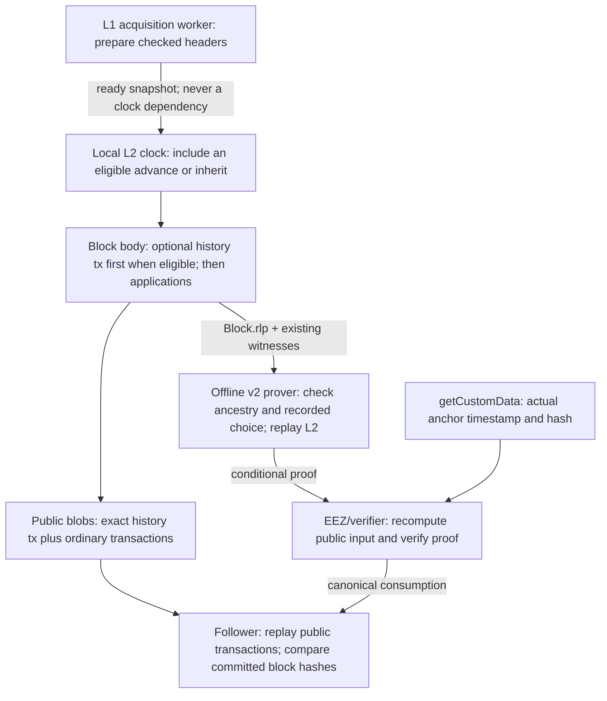

# Recorded L1 history, delayed PREVRANDAO and offline proving

| Field | Value |
| --- | --- |
| Status | Accepted fresh-network behavior, including the native/fee amendments. The [current audit](../audits/2026-10-27-source-counter/README.md) tracks execution-group source indices and versionless `0x45`; [earlier validation](../audits/2026-10-27-group-cleanup-and-history/README.md) covers complete-group cleanup and optional HistoryUpdate before this amendment. |
| Scope | Fresh networks only, active from genesis; no hardfork switch, legacy execution path or existing-network migration. |
| Protocol | Published `feature/e2e_edge_cases`, `84a5b5207880f192a6a5896cbfe0bac5249db47f`. Core interfaces are unchanged. |
| Prover interface | Keep `prove.v2.Prover.ProveStream` and existing witness field `l1_headers_rlp`. One validation-contract version covers encoding and semantics, with a single network profile committed by the registered verification key. |
| Owning contracts | [History predeploy](../../contracts/L1_HISTORY_SPEC.md), [signer specification](../../crates/eez-proof-signer/SPEC.md), [streaming contract](../../crates/eez-control-rpc/STREAMING_SPEC.md), [portable identity](../../crates/eez-control-rpc/VALIDATION_IDENTITY.md). |

## Accepted branch scope after divergence review

This section records the owner's decisions from the 2026-10-23 review of
[specs-draft divergences](../audits/2026-10-23-specs-divergences/README.md).
It is the scope contract for completing branch `codex/l1-history-offline-proving`.
The inspected implementation is HEAD
`3e23955dc477c9e675364776f118b1cecda75774` plus the local recorded-history changes,
in `artifacts/l1-history-offline-proving`. The dated audit identifies that
baseline; it does not validate the amendments in this section.

**Scope and engineering definitions are closed.** The exact [native transaction,
source identities and collector/profile contract](native-system-transactions.md)
owns the byte-level definitions. This proposal defines the fresh-network behavior.
There is one native profile, with no fallback or activation switch.
The renderer fixes the collector to the FeeVault predeploy. Each deployment
selects an initial treasury recipient and owner; the owner proposes a recipient and that recipient accepts
through ordinary L2 transactions. The [treasury amendment](fee-vault-upgrades.md)
adds the transparent proxy and its independent upgrade authority. Validation progress is recorded in the
[native-v1 audit](../audits/2026-10-24-native-v1/README.md) and its
[treasury/RPC extension](../audits/2026-10-24-fee-vault-rpc/README.md), followed by the
[single-profile simplification](../audits/2026-10-24-profile-simplification/README.md).
The [current compliance review](../audits/2026-10-24-specs-compliance/README.md)
tracks the accepted differences against the draft. The subsequent
[PR validation record](../audits/2026-10-24-pr-readiness/README.md) records corrections,
source-process checks and the isolated Kurtosis validation; completed evidence and
remaining checks are listed separately there.

The pinned core takes precedence over the remote draft for ABI, hashes, proxies,
entry execution, static/reverted calls and settlement semantics. The reference
draft is fixed at
[`2c6d346bea0b3736f7453c35174291495694d1fc`](https://github.com/eez-association/specs-draft/tree/2c6d346bea0b3736f7453c35174291495694d1fc).
Its inbound-only version is not a specification of our additional history,
outbound, grouped and callback operations.

### Final behavior selected by the owner

| ID | Required target behavior | Implementation/acceptance obligation |
| --- | --- | --- |
| A1 | Cross-chain `0x45` and dedicated history `0x46`; no system-account nonce | Update exact encoding, hashing, recovery, execution, receipts, RPC, Engine, database and replay. Reject malformed envelopes and unsupported versions. Ordinary user nonces are unchanged. |
| A2 | `SYSTEM_ADDRESS = 0xfffffffffffffffffffffffffffffffffffffffe` | Update every producer/consumer and contract authorization. Preserve EIP-2935 block-system operations and prove that native execution does not increment the account nonce or leak temporary protocol credit. |
| A3 | Keep EEZL2 at `0x4B2760F84B83d6b3829E30A7573B0172B6d6402C`, with the pinned core's upgradeable proxy | Do not move EEZL2 to the draft's predeploy namespace. Keep the history predeploy at `0xeeeeeeeeeeeeeeeeeeeeeeeeeeeeeeeeeeee0077`; install the initially empty upgradeable store and regenerate its proxy, implementation and genesis. The L1 registry remains independently configured and authenticated. |
| A4 | Recompute `sourceHash` from authenticated context and canonical operation position | Cross-chain occurrences have a sourceHash; history updates have none. Preserve original positions through filtering, whole-group partial consumption and replay. An occurrence identifier never authorizes execution or minting by itself. |
| A5 | Explicit, metered native gas; no native fees | Require the encoded cross-chain gas limit to equal `min(remainingBlockGas, 16_777_216)`. History has no encoded gas field; derive `min(remainingBlockGas, 2_000_000)`. Reject mismatched cross-chain limits rather than clamping supplied bytes. Keep the existing whole-group capacity/refusal rules. |
| A6 | Clear SYSTEM/EEZL2 balances after each complete cross-chain group, before its checkpoint; clear remaining balances at block finalization | Accepted 2026-10-27 amendment: a load, paired user transaction, all roots and callbacks remain whole. Full committed funding is independent per group. Preserve mint rollback and clear residual balances after included revert/halt as well. See the [native execution rules](native-system-transactions.md). |
| A7 | Credit ordinary L2 base fees to a network fee collector; priority fees still go to the beneficiary | Apply the credit after each ordinary transaction using its final charged gas, including reverted transactions. Native transactions pay zero. Every intermediate prefix root and final state root must include exactly the same credit. |
| A8 | Preserve recorded L1 history, delayed PREVRANDAO and continuous ordinary L2 production | Retain both anchor modes, bounded nonempty imports, explicit omission semantics, multipart catch-up, complete ancestry witnesses and all existing delay/reorg checks. Change the transaction representation without making production depend on L1 arrival or proving. |
| A9 | Keep proving wire v2 and an offline, language-neutral prover contract | No signer L1/L2 RPC, new RPC version or original-L1-transaction replay requirement. Recompute all existing commitments independently. Publish the final identity and conformance vectors for Nethermind/C# implementers. |
| A10 | Keep this fork's compact V0 counts and supported core call profile | No competing DA decoder. Preserve whole outbound groups, nested callbacks, static/reverted tables, partial consumption and block-hash commitments. A newer core feature alone does not widen the signer's admitted profile. |
| A11 | Use this network's own execution-fork calendar | Do not import Ethereum mainnet activation dates automatically. Retain the selected Osaka profile; future execution-rule changes require their own explicit activation design. |

### Cross-chain envelope and identity requirements

The cross-chain body is:

```text
0x45 || RLP([chainId, sourceHash, gasLimit, to, value, input])
transactionHash = keccak256(exact typed transaction bytes)
receipt = 0x45 || RLP([status, cumulativeGasUsed, logsBloom, logs])
```

There are exactly six fields, no version, signature or nonce, canonical minimal RLP
integers, a 32-byte source hash and a 20-byte destination. `chainId` equals the
configured L2 chain ID. Gas is uint64; value is uint256. Validate byte equality,
field bounds, destination, authorized calldata/value, position and complete input
consumption.
The [source identities and execution rules](native-system-transactions.md#exact-source-identities)
are bound by the single network validation identity. No envelope version or
alternate decoding mode exists.

The implicit sender is A2. Native execution must not validate or increment its
account nonce. Standard RPC nonce/signature fields, where required for generic
consumers, are zero placeholders rather than transaction fields. Expose the real
`sourceHash` and encoded gas limit; omit `version` for cross-chain transactions. Preserve standard inclusion,
receipt, cumulative-gas, log and trace positions. Public signing, transaction-pool
and raw-transaction submission paths must reject the native type.

The [draft's inbound identity](https://github.com/eez-association/specs-draft/blob/2c6d346bea0b3736f7453c35174291495694d1fc/docs/rollup0-spec/F-system-transaction-design.md#f3-exact-envelope)
is the reference for a single inbound occurrence. It binds the envelope version,
L1 chain ID, L1 registry, EEZ rollup ID and L2 chain ID, then the intended live
settlement timestamp, parent hash, original manifest position and pinned-core
call hash. It does not use the eventual L1 transaction hash, child block hash,
transaction/log index or account nonce. Different outer L1 transactions may
perform the same authenticated ordered call. Inclusion and canonical consumption
remain separate checks.

History uses the separate three-field `0x46` envelope specified below. Its exact
bytes are committed in the block and DA; no sourceHash is needed. Reposting a
recorded range cannot change those bytes or replace omission with an import.

The cross-chain source-identity contract covers:

- **Outbound table loads:** bind the original signed L2 transaction and its
  canonical group position; retain the single load/user transaction pairing.
- **Multiple effects and callbacks:** preserve the original bracket and root
  indexes, including failed/static/reverted gaps. Callbacks remain inline in the
  pinned core's tables; there is no standalone callback-native kind. The canonical reconstruction has no standalone callback representation.
- **Partial consumption:** preserve positions within the original authenticated
  candidate. Replaying a suffix must not restart numbering at zero. Recomposition
  into a new candidate must recompute its context and identities together.

Use shared checked types/rules in `eez-protocol`, with role-specific callers.
Never derive identity from a block hash or result that itself contains that
identity. An execution ACK is not authority to sign: all source/context checks
that need Finalize's authenticated settlement input must finish before Proof.

### Fee collector and state transition

For each ordinary transaction, let `chargedGas` be the final gas charged by the
active EVM rules after refunds and any applicable gas floor. Credit:

```text
collectorCredit = block.baseFeePerGas * chargedGas
```

This is the base-fee portion already charged to the sender, not an additional
debit or an additional credit of the priority fee. Keep the EIP-1559 fee update,
ordinary fee caps, gas accounting and value transfers. Credit the collector
before the next transaction or any prefix checkpoint, including after an ordinary
transaction reverts. A native history/load/delivery contributes no fee credit.
Use checked arithmetic. Crediting an account balance does not invoke its code.

The collector is a required, nonzero network parameter fixed before genesis and
must differ from the accounts cleared by protocol balance cleanup. The renderer
selects FeeVault at `0xeeeeeeeeeeeeeeeeeeeeeeeeeeeeeeeeeeee0078`. Its owner may
change its withdrawal recipient through ordinary L2 execution, without changing
this network parameter. The required
field is `config.rollupX.feeCollector`; [Profile and portable identity](native-system-transactions.md#network-profile-and-portable-identity)
authenticate it. The independently loaded node, follower and signer configuration,
registered verification key and deployment rendering must agree. The [configuration contract](native-system-transactions.md#one-authenticated-configuration-source)
fixes validation, propagation and rendering. Missing/empty/malformed/conflicting
settings fail; no runtime override is permitted.

Tests must cover ordinary success/revert, refunds/floors, no native fees,
collector equal to an ordinary sender or beneficiary, multiple transactions,
balance cleanup separation and every committed partial-execution checkpoint.

### Work deliberately outside this branch

| Review item | Owner disposition |
| --- | --- |
| Additional settlement wrapper | Deferred. Keep direct publication and current manager checks; do not claim wrapper-specific dispatch or one-settlement-per-L1-block guarantees. |
| Prover execution of original signed L1 triggers and all L1 bundle prefixes | Not added. Retain the existing conditional proof boundary, exact L2/table/DA validation and on-chain EEZ consumption checks. |
| Several simultaneous provers and signature collection | Deferred. Keep the current single-proof-system pipeline; support for another implementation language does not imply multi-prover aggregation. |
| EIP-7702 admission into the cross-chain Composer queue | Desired future support, deferred. Preserve the current admission restriction in both directions. The ordinary L2 EVM already supports 7702; extending queue/classification/simulation support later does not itself require an L2 execution hardfork. |
| Signed unsafe-block announcements | Not required for this branch. Existing unsafe following does not acquire a new producer-signature requirement. |
| General peer/checkpoint bootstrap after blob expiry and arbitrary-depth nonfinalized reorg recovery | Deferred. Preserve existing recovery and its explicit limits; do not reinterpret local history limits as consensus limits. |
| Durable pending requests/retry counters | Deferred. Queues remain in memory; restart can require client resubmission. |
| New asynchronous withdrawal mechanism | Deferred; the draft has no complete accepted mechanism. Existing synchronous outbound support remains. |

The existing core's broader call/queue semantics prevail over the draft's
inbound-only restrictions. Preserving them is not authorization to add a new
unsupported signer profile. General Nethermind node/Engine integration, live
deployment and migration of existing networks are not part of this branch.

### Engineering closure and remaining acceptance evidence

No product or permission gate remains. The implementation contract is defined;
reference encodings do not establish executable conformance. The
[engineering-closure record](../audits/2026-10-23-specs-divergences/engineering-closure.md)
records independent review and the executed encoding checks:

| ID | Status | Definition/evidence |
| --- | --- | --- |
| E1 | Specified | Versionless cross-chain envelope with an execution-group source formula; dedicated optional history version 1; full Live Sync group ordinals; inline callbacks; retry/partial-consumption rules. See [native specification](native-system-transactions.md#exact-source-identities) and [reference encodings](../../crates/eez-control-rpc/conformance/native-profile-v1.json). |
| E2 | Specified | Required genesis feeCollector, propagation/rendering, exact NetworkProfile and validation-contract version 7. See [configuration](native-system-transactions.md#fee-collector-configuration-and-execution) and [profile/identity](native-system-transactions.md#network-profile-and-portable-identity). The fixed FeeVault predeploy receives base fees; its initial owner and recipient are selected for deployment. |
| E3 | Complete within this repository | A1–A11, regenerated runtime/genesis/profile, real captures, all 29 v2 corpus cases, independent oracles and the selected integration/replay matrix pass. The [validation audit](../audits/2026-10-24-native-v1/README.md) records initial failures, corrections, exact scope and CI/external-Nethermind limits. |

The `DELEGATECALL`/`CALLCODE` case in audit C09 follows the pinned proxy's caller
and selector dispatch. An unregistered execution context cannot dispatch a
cross-chain call. A manager-originated `DELEGATECALL` can preserve the authorized
`executeOnBehalf` caller and perform an ordinary local call; `CALLCODE` changes
that caller. Its `staticCheck()` self-probe can also succeed without dispatch.
The [contract regressions](../../contracts/test/CrossChainProxyPolicy.t.sol)
exercise these branches on L1 and L2. The inspector leaves both opcodes to EVM
execution; success alone is not evidence of a cross-chain operation. No opcode
ban or proxy bytecode change is part of this work.

### Implementation and test ownership

| Area | Required integration | Meaningful regression coverage |
| --- | --- | --- |
| `eez-primitives` | Native envelope, RPC/receipt/storage/Engine representation | Independent exact bytes/hashes, canonical RLP, wrong version/field count/width/chain/destination and unknown-type rejection |
| `eez-protocol`, codecs | Source identities, semantic original positions, shared gas/profile rules; keep compact V0 | Duplicates and role separation, whole groups, filtered positions, partial-prefix replay, canonical DA and unchanged core hash/KZG oracles |
| `eez-evm` | Sender, no native nonce increment, exact gas, cleanup, collector credit, recorded history | State transitions and rollback, EIP-2935 coexistence, actual PREVRANDAO, receipts/gas, post-transaction balances and intermediate roots |
| Composer, driver, deriver/follower | Construct and rederive identical bytes; preserve ownership and local clock | Build/replay equivalence, retries, failed outbound carriers, partial consumption, restart, real reorgs, missed/late L1 and unavailable prover |
| `eez-proof-signer`, control RPC and prover client | Authenticate the amended profile and all native occurrences before signing; retain v2 | Wrong source context/collector/profile rejects, cold offline replay, rewind/resume isolation, both anchors and exact public-input recomputation |
| Local contracts, genesis/deployment tooling | Upgradeable history proxy/implementation, collector/profile binding, updated fixtures and configuration consumers | Solidity/Rust profile agreement, generated genesis check, config propagation and mismatched configuration failures |
| External integration documentation/corpus | Publish one language-neutral contract for Nethermind/C# | Independent portable vectors and existing v2 transcript harness; actual external-client execution remains separately evidenced |

Use the existing [validation matrix](../../AGENTS.md#build-and-validate), pinned
toolchains, locked Cargo graph, Foundry and source-based process tests. Do not add
a second test framework, replace independent oracles with self-generated expected
values, or treat an empty/ignored-only selection as validation. Port the existing
history, cross-chain, nested/static, fee, queue and recovery regressions to the
final profile. Record actual commands, source/executable identity, first failures,
fixes and remaining unavailable lanes in a new dated validation record.

This remains a coordinated **fresh-network** change: one genesis, one canonical format per native
kind and one supported profile across Composer, follower and prover. No legacy
decoder, historical-format execution, existing-network activation or database
migration is required. Existing tests and generated data remain baseline evidence
until rebuilt and rerun for the new bytes and fee semantics. Publishing or
deploying the branch is a separate action.

## Intended behavior

A bootstrapped sequencer with available local execution and storage continues
ordinary L2 production on its configured clock while L1 delivery, settlement or
the prover is unavailable. It inherits the last installed L1 origin until an
eligible, authenticated advance is available. Omitting the optional history
transaction means inheritance; it does not assert that a missing L1 slot was empty.

The L2 history contract starts empty and permanently retains the explicit L1
number/hash pairs recorded by system transactions. Gaps are valid and cannot be
backfilled; the default producer fills consecutive available numbers. At scheduled
updates it may import up to 64 pairs. Omission inherits the last execution origin,
or the configured genesis reference while empty. That origin also determines
PREVRANDAO. Followers replay the recorded transaction; later header arrival cannot
reinterpret old blocks.

The prover receives blocks and witnesses over v2 and needs no L1/L2 RPC, persistent
header database or hidden cache. Its proof is conditional on the L1 anchor
that `getCustomData()` supplies at actual inclusion. The registered key binds
the network profile, and Core separately checks consumed entry roots.



| Component | Responsibility |
| --- | --- |
| Producer | Choose an eligible advance or inherit from local state and ready evidence; record exact transaction bytes. Acquisition runs separately. |
| Offline prover | Validate header encoding/linkage, inherited state, every recorded import and its delay; execute the actual PREVRANDAO and transactions; recompute all block, DA, settlement and public-input commitments. |
| `getCustomData()` | Return the inclusion timestamp and parent hash, or zero timestamp and an available historical L1 hash. |
| EEZ and verifier | Bind the anchor context and registered network key into the public input; verify the proof and consumed entry roots. |
| Follower | Reconstruct from public DA and authenticated L1 ancestry; execute the same history transactions and native action groups. |

The manager does not replay L2 or parse the supplied historical headers. The
current backend is an authorized ECDSA attester, not a ZK proof of execution.
An external Nethermind/C# implementation must enforce the same validation
contract and portable identity; a future ZK backend must prove those relations.

## Schedule and public system transaction

The fixed genesis profile defines:

```text
T0 = genesis timestamp / Sync alignment
delta = L2 block interval
k = blocks per Sync interval; I = delta * k
q = history update offset, 0 <= q < k
T(n) = T0 + n * I
U(T) = T + (q + 1) * delta
```

Before the first update the public store is empty; execution inherits the
authenticated genesis reference and its PREVRANDAO. At U(T), the producer MAY
include one HistoryUpdate at transaction zero:

```text
wire = 0x46 || RLP([version = 1, chainId, [[number, blockHash], ...]])
1 <= blocks.length <= 64
```

The [history contract](../../contracts/L1_HISTORY_SPEC.md) owns the exact native,
proxy, storage and application contract. The engine derives system sender,
predeploy destination, zero value, `importL1Blocks` calldata and
`min(remainingBlockGas, 2_000_000)` gas. No origin is added to extraData and
prove.v2 is unchanged. Exact bytes travel in the V0 prefix and Block.rlp.
Cross-chain 0x45 and its source identities remain separate.

Each positive, strictly increasing pair must match authenticated headers and
cannot regress the logical origin. The first update may include the positive
genesis reference; later updates advance beyond the stored endpoint. Gaps are
allowed in storage and cannot be backfilled. Every intervening header is still
required for authentication, including those not selected for storage. The final
selected timestamp must be at most T. Default producer policy fills consecutive
available pairs, up to 64; replay follows recorded bytes, not producer policy.

Omission inherits origin and PREVRANDAO without writes, including eligible empty
blocks. Duplicate, misplaced, off-schedule, empty or malformed updates invalidate
the block. Later updates need no intervening empty imports. Both L2 mixHash and
the actual PREVRANDAO opcode match the selected header before applications run.
A storage write alone cannot configure the opcode environment.

The proxy at the fixed public address delegates to the implementation selected
by authenticated state. Imports remain system-only, nonce-neutral, fee-free,
without mint, output or logs, and metered within the 30M block gas limit. Existing
EIP-2935 and balance-cleanup rules remain unchanged. Upgrades are ordinary signed
L2 transactions; the owner is trusted with implementation behavior. Compatible
upgrades retain the contract layout and execution invariants.

Getters return zero for unavailable records, including skipped numbers, and the
latest getter returns `(0, 0)` when empty. Applications must follow the
[polling rules](../../contracts/L1_HISTORY_SPEC.md#application-polling); they cannot
infer contiguous coverage from the endpoint. A supplied header and storage proof
still need a nonzero stored commitment. Validation-contract version 7 binds the
new fresh-network profile. See its
[compatibility boundary](../../contracts/L1_HISTORY_SPEC.md#compatibility).

## Delay and late L1 delivery

The delay is a minimum source age and an update opportunity. It accommodates
latency without requiring proof that no newer header exists. It provides neither
finality nor guaranteed freshness or unpredictable application randomness.
The sequencer may withhold an eligible advance; that discretion is an explicit
tradeoff of production without external freshness information.

For I = 12 seconds and delay = 6 seconds:

| Time | Result |
| --- | --- |
| 12 | H100 remains installed; no new eligible evidence is ready. |
| 18 | No history transaction is included; L2 keeps H100 and its PREVRANDAO. Applications continue. |
| 21 | H101, timestamp 12, arrives nine seconds late. Acquisition prepares it; old blocks stay unchanged. |
| 30 | Next scheduled tx may install H101 or a newer eligible endpoint within the 64-record budget. Both origin and PREVRANDAO change together. |

A missed L1 slot has no produced block number and creates no synthetic
zero hash. The default producer imports received headers consecutively in bounded
updates, including headers never selected individually. Recorded sparse imports
remain valid but permanently omit the skipped records. A real canonical L1 reorg
can invalidate imported history. Conditional cross-chain proposals can also be
replaced. Continuing production does not make unsettled receipts irreversible.

## Clock, settlement and ownership

Ordinary production uses the immutable L2 grid and local parent state. It does
not await L1 RPC, a new head, a prover response, settlement or a bounded number
of unsettled blocks. Ordinary Sync boundaries remain structural checkpoints,
carrying an optional nonempty history update when eligible evidence is ready.

One bounded preparation worker handles L1-triggered live opportunities and
retained ordinary settlement. A slow worker does not occupy the local clock.
Remote reconciliation reads occur outside the shared production lock; under the
lock, recheck generation and exact local predecessor before applying effects.
Stale candidates cannot overwrite a newly advanced parent. A closed scheduler
channel does not terminate ordinary production.

Before advancing an ordinary parent, Composer ensures that parent's exact witness
is in local durable storage. This bounds capture lag during fast catch-up before
Reth can discard the needed trie overlays. It uses the existing local witness
source, without waiting for remote proof validation or L1. Local execution and
storage capacity still bound production throughput.

The existing four deadline-based replacements on an unchanged L1 parent limit
settlement attempts only. Preserve old submission identities and single current
ownership. Exhaustion does not stop ordinary blocks. New L1-dependent actions
remain pending until their actual execution context is available; uncertainty
cannot authorize execution, completion, eviction or a user failure charge.

The L1-derived safe head still requires publication and canonical consumption.
A follower consuming only L1 cannot advance that safe head during a publication
outage. Restart retains the existing volatile request/counter limitations;
clients may need to resubmit unsettled work. Local disk exhaustion or an execution
failure is outside the promise of independence from L1 availability.

## Both anchor modes

Let N/S be the actual L1 inclusion number/timestamp and E the terminal L2 timestamp.
Ranges begin and end at the profile's Sync boundaries.

| Rule | Actual parent (mode 1) | Historical anchor (mode 2) |
| --- | --- | --- |
| `batch.blockNumber` | `uint64.max` | Explicit B, `0 < B < uint64.max` |
| L1 commitment | N − 1 and `blockhash(N − 1)` | B and `blockhash(B)` |
| Inclusion binding | Exact parent and S | Available B/hash, eligible signed entries and registered key |
| Execution | E = S permits supported live actions; E < S is ordinary catch-up; E > S rejects | E <= timestamp(B); ordinary catch-up only |
| Cross-chain actions | Only at E = S and under existing action validation | Forbidden, including static/failed/nested observations without an L2 transaction |
| Age | Actual parent available | B < N, N − B <= 256, nonzero hash |
| v2 `posting_context` | Required with existing exact target/parent meanings | MUST be absent; derive B from calldata and header facts from the witness |

Historical timestamp eligibility also implies that B is later than every delayed
source cutoff in the window. It does not require the chosen origin to be maximal.
Historical proofs can survive later inclusion while the anchor is available,
the registered key remains valid and Core's signed-entry checks succeed.
Accepted-root advancement alone does not expire them. Never reinterpret a
failed live proof as historical catch-up.

Core `Rollup.sol` is used unchanged. Its `getCustomData` returns only the original
timestamp/hash pair: inclusion time and parent hash in actual-parent mode;
zero and `blockhash(B)` in historical mode. The registered vkey binds the network
profile and validation program. See the accepted
[manager simplification](rollupx-manager-simplification.md) and exact
[profile/key encoding](../../crates/eez-control-rpc/VALIDATION_IDENTITY.md).
Known compatible L1 rule transitions are allowed. Incompatible upgrades require
coordinated on-chain revocation/replacement of old keys or proof systems.

## Offline evidence and acceptance

Every proof carries canonical raw L1 headers from the inherited history endpoint
through its exact anchor. Require exact fork-aware decode/re-encode equality,
locally computed hashes, consecutive numbers, parent links and strictly increasing
timestamps. No duplicate, omitted, reordered or conflicting header is allowed.
Include every bridge-only header even if no L2 update imported or selected it.

Execution authenticates the inherited endpoint against the L2 state witness,
checks every recorded update and replays all transactions. Finalize authenticates
the entire checked ancestry against the chosen anchor. There is no successor or
latest-source test: subsequent headers cannot change a recorded valid choice.
Missing evidence rejects the proof, never invokes a chain RPC or freezes the
independent producer.

The batch contains one unsigned self-rollup expected-root pin, checked by Core
at admission. It does not authenticate replay. Signed entry roots and complete
checkpoints are independently validated, and Core decides applicability during
consumption. Partial consumption can reuse a signature while its signed bytes,
key policy and anchor remain valid; no whole group may be split.

## Multipart recovery outside the L1 blockhash window

Four days is an example of old history, not a required wall-clock test duration.
Choose a recent available anchor and prove the complete parent-linked bridge
from the old origin. L1 only resolves the recent anchor; it need not expose each
old hash through `BLOCKHASH`.

Settle admitted Sync-aligned ordinary ranges in parts, preserving exact recorded
transactions. Each part starts from authenticated accepted state, checks its
complete applicable ancestry and advances only after canonical consumption.
Proof generation or a receipt alone is not progress. Cold prover restart must
work from full request evidence. Retained execution sessions are an optimization.

Imports are capped at 64 stored pairs per scheduled transaction. Evidence remains
bounded by the existing 131,072-header and aggregate witness/session quotas.
Splitting only L2 blocks does not shorten an arbitrarily old-to-recent L1 bridge.
Recovery beyond those evidence limits is not specified; it needs a separate
bounded ancestry-authentication design. Hitting a proof limit must defer
settlement without stopping local production or truncating evidence.

## Compatibility and validation

Deploy new matching genesis, Core manager and registered key, Composer, follower and prover.
No old network/database replay, in-place upgrade, dual execution mode or rollback
compatibility is provided. Regenerate fixtures with the existing genesis script;
keep pinned Solidity/compiler metadata and the core gitlink. Wire v2 remains
unchanged; validation-contract version 7 and the registered key bind cross-chain and history
encoding, complete-group and block-finalization cleanup, execution rules and the fee collector used by
every component. Cross-chain source identities remain unchanged.
The derived correlation index uses `eez-batch-correlation-recorded-history-v1`.
Each accepted checkpoint retains its executed history state as well as its
header, so a resumed batch may replace that L2 height without breaking recovery.
Recovery reauthenticates the L1 occurrence and selected header; a stored record
does not establish canonicality by itself. Older index formats are rejected.
No `EEZ_PROOF_SIGNER_L2_RPC_URL` or signer L1 source is introduced. Internal Engine
payload attributes carry the exact transaction and bind it in the payload ID;
those attributes are separate from the proving RPC.

| Requirement | Required regression evidence |
| --- | --- |
| Continuous local clock | Missed/late/closed L1 source and stalled preparation/prover; more than four opportunities and 64 unsettled blocks; ordinary transactions execute. |
| Recorded selection | Omit an eligible update, then receive a late header; omission preserves state and PREVRANDAO, and a later valid advance agrees with the actual opcode. |
| Transaction validity | Reject duplicate/misplaced/off-schedule updates, empty or noncanonical RLP, wrong chain/version, explicit source/gas/value/target fields, over-64 imports, too-new/regressing origin, wrong ancestry and PREVRANDAO. Omission is valid. |
| Metered execution | Receipt, native nonce absence, exact gas, system balance cleanup, conflict/revert rollback and history-before-application ordering. |
| Public replay | Composer, network-denied cold signer and independent follower agree for both modes and history-only Sync checkpoints. |
| Recovery and ownership | Bounded parts, expired old sources, unused bridge tampering, partial consumption, replacement bounds and real reorgs. |
| Profile consistency | Independent Solidity/Rust context and identity vectors, mismatched-profile rejection, generated genesis and portable v2 conformance. |

The dated [baseline audit](../audits/2026-10-23-portable-prover/README.md) and
[continuity investigation](../audits/2026-10-23-l2-continuity/README.md) record earlier
behavior and limitations. Their passing results must not be presented as evidence
for this implementation. Record new executed checks and remaining gaps separately.
