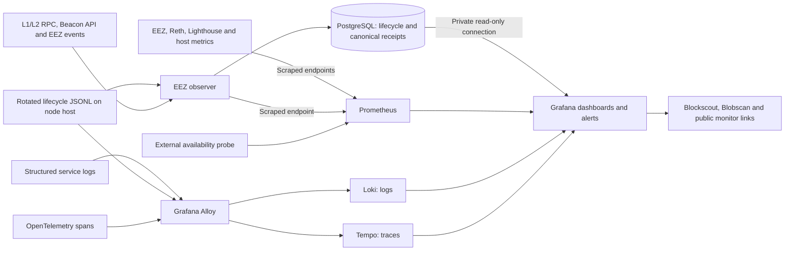

# EEZ network observability proposal

Draft implementation plan, 2026-09-16. Based on repository inspection and current vendor documentation; no live deployment inspection or changes were performed. Implementation has started in `feat/network-observability`; see [exporter evidence](../../observability/validation/initial-slice.md) and [backend evidence](../../observability/validation/backend-stack.md). Work packages remain incomplete unless that evidence explicitly says otherwise.

Reviewed twice by Claude using the proposal text only, followed by local source verification by Codex. See the [original review](network-observability-claude-review.md), [follow-up review](network-observability-claude-followup.md), and [finding dispositions](network-observability-review-disposition.md). The implementation decisions at the end of this document resolve the review findings; remaining integration checks have explicit fallbacks and do not block the RPC-based first release.

**Recommendation.** Deploy a fully self-hosted telemetry system: Grafana as the operator interface, Prometheus for metrics, Loki for searchable logs, and a small EEZ observer with PostgreSQL for canonical settlement and cost records. Use Alloy for log collection and OpenTelemetry transport, and add Tempo for distributed traces. Keep instrumentation and dashboards version-controlled. Keep the existing public monitor, Blockscout, and Blobscan as linked inspection tools. Self-hosting is a user requirement; no Grafana Cloud dependency is proposed.

Assume one Chiado deployment initially, with a separate devnet environment and eventual additional nodes/rollups. The first objective is to answer: Is the network working? Which cross-chain requests are waiting, and why? What constrains settlement? How much are we spending? Can a follower recover the settled chain?

**What already exists.**

| Existing capability | How to use it | Remaining work |
| --- | --- | --- |
| [Queue RPC](../../crates/eez-node/src/queue_rpc.rs): `eez_getCrossChainQueueStatus`, `eez_getCrossChainTransaction` | Queue health and transaction drill-down | Export aggregate metrics; persist lifecycle observations; add missing dimensions in native instrumentation |
| [Queue status](../../crates/eez-composer/src/held_pool/status.rs) includes readiness counts and pending/service ages | Distinguish blocked requests from serviceable work | Preserve unknown/null semantics and report observation freshness |
| [Settlement correlation RPC](../../crates/eez-node-common/src/correlation_rpc.rs): `eez_getSettlementByL2Block`, `eez_getSettledL2RangesByL1Block` | Link L2 ranges to canonical L1 settlements | Durable incremental indexing and reorg reconciliation |
| Composer structured events and signer JSON logs | Explain preparation cuts, submissions, recovery and signer decisions | Consistent event fields, central retention and stable metric contracts |
| Embedded Reth L1/L2 and Lighthouse | Client and peer health | Enable and verify metrics for the pinned builds; distinguish embedded instances |
| [Public monitor](../../testing/public-gateway/README.md), [Blockscout and Blobscan](../../deploy/explorers/README.md) | Inspect transactions, blocks, blob contents and existing archive | Link Grafana incidents and batch records to these views; monitor indexer freshness |
| Historical gas/blob audits | Reference fixtures for accounting validation | Continuous receipt-backed accounting |

The inspected deployment manifests do not wire a Prometheus/Grafana stack. The public monitor's implementation lives in the separate `eez-rollup-ui` repository; this proposal does not assume its internal collector is reusable without inspection. A signer TCP health check proves that a port accepts connections, not that requests can be validated and signed.

Upstream [Reth](https://reth.rs/run/monitoring/) and [Lighthouse](https://lighthouse-book.sigmaprime.io/api_metrics.html) support Prometheus metrics. EEZ embeds both execution chains in one process: verify recorder registration and chain labels against the pinned implementation before assuming stock flags yield independently attributable L1/L2 metrics.

**Architecture.**



[Grafana Alloy](https://grafana.com/docs/alloy/latest/) supports Prometheus and OpenTelemetry signals. For this deployment, let Prometheus scrape metrics directly and use Alloy for logs and OTLP traces; avoid collecting the same metric twice. Run Alloy close to the node, with bounded buffers and resource limits. Collect host CPU, memory, disk space/latency, network traffic and container restarts alongside application signals. Keep collection asynchronous and outside sequencing/signing critical paths.

Run the observer as a separate service on the node host, with read-only access to the dedicated lifecycle files and local RPCs. Grafana, Prometheus, Loki, PostgreSQL and later Tempo run on the monitoring host; Alloy also runs on the node host. The observer writes to PostgreSQL over the private network, with its file checkpoints stored transactionally alongside imported events. No remote filesystem sharing is required. Stage 1 uses a database-free RPC-exporter mode; stage 2 enables canonical and lifecycle indexing. Use subscriptions as wakeups, with persisted cursors and polling/backfill as recovery. Every source exposes collection success and last-success time.

Use a dedicated PostgreSQL database/schema with a separate write identity for the observer and a read-only Grafana identity. [Grafana supports PostgreSQL queries and dashboards](https://grafana.com/docs/grafana/latest/datasources/postgres/). Connect over a private Docker network or private host network. Do not publish the database on the internet.

Prometheus holds bounded aggregate time series. PostgreSQL holds transaction hashes, attempt relationships, exact receipt values and canonical status. Logs explain decisions. Traces will connect time spent in simulation, witness construction, signing, builder submission and reconciliation. None of the telemetry stores becomes protocol-authoritative.

**Code instrumentation and a unified telemetry design.**

Yes, instrument EEZ directly. Metrics and distributed tracing belong to one telemetry design, while the observer provides the protocol-specific indexing that general telemetry collectors do not perform. Share identity conventions and Grafana navigation across all four stores; keep their ingestion responsibilities distinct.

Add a small `eez-telemetry` crate for common metric definitions, structured event fields, service identity and optional tracing/export configuration. The application entrypoints own initialization. Existing EEZ code already uses `tracing`, and `Cargo.lock` includes `metrics`, `metrics-exporter-prometheus`, `opentelemetry`, and `tracing-opentelemetry` transitively. Their presence does not establish that EEZ exports these signals today. Reuse compatible versions and the existing Reth subscriber/recorder rather than installing a competing global subscriber or recorder.

| Signal | Code change | Storage and use |
| --- | --- | --- |
| Metrics | Use the Reth-compatible Rust `metrics` facade for counters, gauges and histograms; expose a private Prometheus endpoint per process | Prometheus for rates, queue depth, duration distributions and alerts |
| Logs/events | Extend existing `tracing` events with stable names and context; emit structured JSON | Alloy to Loki for searchable diagnostic history |
| Traces | Add stage spans and bridge `tracing` through `tracing-opentelemetry`; export OTLP asynchronously | Alloy to Tempo for cross-service timelines |
| Canonical records | Separate observer reads chain events, receipts and EEZ RPCs and reconciles forks | PostgreSQL for exact accounting and request/batch drill-down |

Prefer one metrics API in EEZ initially. OpenTelemetry can carry metrics too, but adding OTel metrics alongside the existing Reth-compatible metrics path would introduce a second instrumentation pipeline without a demonstrated need. Prometheus metrics and OTel traces work together in the same self-hosted system. Follow [Prometheus instrumentation guidance](https://prometheus.io/docs/practices/instrumentation/) and validate the [Rust OpenTelemetry dependencies](https://opentelemetry.io/docs/languages/rust/) against the pinned runtime before implementation.

Define shared context now: deployment identity, chain ID, rollup ID, service and instance. Diagnostic events and SQL observations additionally carry source transaction hash, attempt ID, settlement transaction hash, block hash and trace/span IDs when available. A retry gets a distinct attempt ID. A batch can contain many source requests, so use span links for those relationships rather than pretending each batch has one source parent. Propagate trace context explicitly across composer-to-signer gRPC metadata and asynchronous work boundaries. Keep diagnostic context outside consensus payloads, signed public inputs and transaction encoding.

For example, an alert about rising cross-chain latency opens a Grafana queue panel; a request row links to its preparation/signing trace, correlated logs and canonical receipt costs. SQL stores the relevant identifiers, not a duplicate of every trace span. Transactions and batches remain discoverable after traces expire or are sampled out.

The observer may ingest versioned lifecycle events to preserve acceptance, queuing and attempt history. Diagnostic logs and sampled traces alone are insufficient for complete lifecycle accounting. Include event sequence/epoch information and gap reporting; reconcile canonical outcomes from chain data. If complete pre-settlement history is required across observer outages, add a bounded durable event outbox with replay and explicit retention-gap semantics. This adds scope and must not introduce synchronous database writes into settlement. Chain indexing can backfill canonical data; it cannot reconstruct unrecorded queue decisions.

Define span, event and metric identities together in WP0. Stage 1 ships RPC-based visibility and only the native endpoint/identity integration proven safe by WP0; transition instrumentation belongs to WP4 and distributed span export to WP5. Enable Tempo with a small trace pilot in stage 2, and expand cross-service coverage in stage 3. Distributed traces may be sampled or lost; receipt accounting remains unsampled and reorg-aware. Neither the node nor signer connects directly to PostgreSQL.

**Six dashboards.**

| Dashboard | Questions and panels |
| --- | --- |
| Network overview | L1 head and finality age; independent reference-head lag; L2 unsafe/safe/finalized heads; unsettled blocks and oldest unsettled age; last canonical settlement; throughput; service and data-source freshness |
| Cross-chain operations | Inbound/outbound accepted, queued, ready, blocked, unknown and in-flight work; oldest serviceable and pending ages; blocking reasons; completion p50/p95/p99; retries, replacements and terminal outcomes; per-request timeline |
| Settlement pipeline | Preparation, simulation, witness, signer and submission duration; candidate attempts versus canonical batches; target-slot misses; admission cuts by gas, DA, count and preparation deadline; rollback/recovery; active settlement policy |
| Blobs and DA | Purchased blob count; encoded stream bytes; purchased-capacity utilization; allowance utilization; execution versus blob fee; blob retrieval latency/failure; archive coverage and follower derivation lag |
| Gas and economics | Receipt execution gas and effective prices; blob gas and price; poster versus companion costs; cost per batch, settled L2 transaction and completed source; daily spend; poster/system account balance and spend-based runway |
| Infrastructure and correctness | Peers, execution/consensus sync, RPC error/latency, CPU/RAM/disk, restarts, signer validation failures, observer lag, explorer lag, independent follower state-root agreement at the same settled block |

The overview should open with a small number of status panels and links to the relevant detail dashboard. A stale or missing source displays **unknown**, with its last successful observation. Every dashboard supports environment, chain, rollup, instance and time filters where relevant. Annotate releases, restarts and policy changes.

For cross-chain latency, measure accepted-to-canonical-completion and accepted-to-finality separately. Show blocked time and serviceable waiting time separately. Percentiles of completed requests must be accompanied by pending-age distributions and completion counts so a stalled queue cannot look fast. Distinguish successful cross-chain completion, source-only completion/revert outcomes, rejection and infrastructure failure using the actual protocol outcome taxonomy.

**Accounting rules that make the dashboards trustworthy.**

1. Key a logical transaction by `(chain_instance_id, tx_hash)` and each receipt observation by `(chain_instance_id, tx_hash, block_hash)`. Preserve orphaned/reincluded observations separately. Canonical cost views select at most one canonical inclusion per logical transaction and reconcile after reorgs. Keep attempt IDs distinct from canonical batch IDs; retrying a candidate does not create another paid batch.
2. Calculate execution cost from `gasUsed × effectiveGasPrice`, and blob cost from `blobGasUsed × blobGasPrice` where applicable. Store exact integer values in PostgreSQL; convert only for display. A missing required receipt field is an accounting gap, never an assumed zero.
3. Include canonically included reverted transactions in actual spend. Keep gas limits, reservations, fee caps and simulation estimates separate from paid costs. Attribute shared batch overhead by an explicit allocation rule if showing per-source estimates; do not imply the allocation is an exact per-source receipt charge.
4. Separate poster/operator spend, user-paid L1 companions and L2 user fees. Do not add L2 fees to L1 settlement costs as if they were one external bill. Report native chain units, xDAI on Chiado; any fiat conversion requires a timestamped price source.
5. Measure purchased utilization as `sum(known encoded stream bytes) / sum(purchased blobs for those same posts × 126976)`. The 126,976-byte usable capacity is specific to the current codec and must be versioned. Physical blob size is 131,072 bytes. Report utilization against the active blob allowance separately, with the allowance captured per attempt/batch.
6. Show byte-measurement coverage next to utilization. Do not divide bytes from a partially measured subset by blobs from the complete population. Zero paid blobs yields no utilization value. Calculate aggregate ratios from totals, not averages of per-batch percentages.
7. Derive canonical revenue/cost reports from the reconciled ledger. Use process counters for attempts and operational rates; monotonic counters cannot subtract reorganized settlements. Expose finalized rollups or recomputed window gauges for accounting metrics.

These distinctions already matter here. The earlier local blob-efficiency analysis of the [result-reserves workload](../audits/2026-09-16-chiado-result-reserves/README.md) measured 52.82% purchased-capacity utilization in a captured source-bearing workload, while blob charges were only 2.84% of all captured receipt costs. These are historical testnet measurements with different stated populations, not forecasts. They justify displaying byte efficiency, packing constraints and actual currency spend together.

The observer must expose its restart epoch and collection gaps. Queue state is currently in memory; a node restart can erase pending requests. Historical accepted requests without a durable terminal observation should become unresolved/unknown, not silently completed. A durable monitoring history is useful evidence but does not make the protocol queue durable.

**Initial alerts and service objectives.**

Start with the following tunable rules. Thresholds are provisional and must be calibrated using normal traffic, staged bursts and the configured settlement policy. The recorded workloads include multi-minute completion tails, so a universal 30-second cross-chain deadline would be misleading.

| Stage / producer | Condition | Initial handling |
| --- | --- | --- |
| 1 / independent endpoint probe | Public RPC unavailable for 2 minutes | Page; attach node, gateway and probe context |
| 1 / RPC exporter + reference probe | L1 head age exceeds `max(3 configured slots, 3 poll intervals)` | Warning; escalate only when the reference comparison confirms sustained local failure |
| 1 / RPC exporter | Queue collection fails or its source-state evaluation is stale | Show unknown; warning after 2 minutes; collection success alone does not prove fresh queue evaluation |
| 1 / private process probe | Signer listener or required service unavailable | Warning after 2 minutes; listener availability does not prove signing correctness |
| 1 / host metrics | Disk projected to fill within 24 hours | Warning; add a separately configured hard free-space floor |
| 1 / scrape health + independent receiver | Telemetry missing / dead-man heartbeat absent | Warning after 2 minutes for missing sources; independent page after 3 missed one-minute heartbeats |
| 2 / queue recording rule + observer canonical outcome views | Ready/in-flight work exists, L1 advances, and no cross-chain canonical progress for 2 minutes | Warning; page at 5 minutes initially; observer publishes anchored terminal-progress gauges from lifecycle evidence, retractable after reorg; native counters are cross-checks, not a required producer |
| 2 / policy and unsettled-history instrumentation | Pure-L2 unsettled age exceeds active policy deadline plus inclusion grace | Warning/page by duration; account for intentional batching |
| 2 / balance RPC + canonical costs + funding estimate | Poster cannot fund the next estimated batch, or runway below 24 hours | Page for inability to post; warning for runway; unknown burn rate stays unknown |
| 2 / authenticated blob fetcher | Required current blob cannot be retrieved after retries | Page when derivation is blocked; attach Beacon health and settlement |
| 2 / signer instrumentation | Signer rejects invalid/stale proposals repeatedly | Warning by reason/rate; page when valid-work progress is blocked |
| 2 / observer | Canonical index lag or missing receipt/lifecycle coverage | Warning by configured lag/gap threshold; coverage is shown immediately |
| 3 / independent follower | State root differs at the same canonical settled block | Page after excluding stale/reorg observations; disabled follower remains unknown |

Route all alerts through one alerting system, initially Grafana Alerting, with severity, owner, runbook, deduplication and recovery notifications. Suppress dependent signer/settlement symptoms during a confirmed upstream outage without hiding the underlying data. Configure a dead-man signal checked outside the monitored host.

After a baseline week, define explicit RPC-availability and cross-chain-completion objectives with windows and denominators. Report all accepted requests as a user-experience measure, plus a diagnostic measure restricted to serviceable requests. Do not exclude blocked work invisibly. Initial completion objectives remain provisional until traffic and finality distributions are measured.

**Self-hosted deployment.**

| Component | Initial deployment | Responsibility |
| --- | --- | --- |
| Grafana OSS | One service with provisioned dashboards, data sources and Grafana Alerting | Operator UI and notification routing |
| Prometheus | One server with persistent storage | Scrape EEZ, client, host and observer endpoints; retain aggregate metrics |
| Alloy + Loki | Collector near each application host; single-instance Loki initially | Collect, process and retain structured logs |
| Tempo | Single-instance pilot, then expanded tracing | Store and query OTLP traces forwarded by Alloy |
| EEZ observer + PostgreSQL | Separate service and dedicated database | Backfill and reconcile canonical records; index lifecycle observations |
| Exporters and independent probe | Host metrics and endpoint probes | Resource and availability checks |

Use a separate Docker Compose project under `observability/`, with private endpoints and persistent volumes. Prefer a separate monitoring host so a rollup-host failure does not remove its alerts. A single-host pilot is acceptable with an explicit shared failure domain and a dead-man check on another machine. No Kubernetes or distributed metrics cluster is needed initially.

Initial retention targets: 30 days of metrics, 14 days of logs and 7 days of sampled traces; retain canonical accounting for the deployment lifetime with backups. Measure actual ingest, active series and query load for a week before setting resource allocations and storage limits. Configure supported storage backends and retention/compaction for the pinned Loki and Tempo versions; keep durable accounting backups separate from diagnostic retention. Self-hosted cost is compute, disk, backups and maintenance time.

The implementation choice is Grafana/Prometheus/Loki/Tempo. Alternative-platform evaluation is closed for v1; revisiting it is outside these work packages.

**Delivery plan.**

| Stage | Deliverables and acceptance | Planning estimate |
| --- | --- | --- |
| 1. Operational visibility | Integration investigation, self-hosted metrics/logging stack, RPC exporter, available client/host metrics, common identity contracts, overview/infrastructure dashboards and the explicitly stage-1 alert set. PostgreSQL/Tempo remain disabled profiles. Native endpoint integration is included only where WP0 proves it safe. | 4–6 engineer-days |
| 2. Protocol and cost visibility | Reorg-aware observer/receipt ledger, lifecycle instrumentation, initial Tempo trace pilot, cross-chain/settlement/blob/gas dashboards and explorer links. Reconcile against a saved canonical audit, including companions, reverts and missing byte measurements. | 5–8 engineer-days |
| 3. Reliability and diagnosis | Independent follower checks, sampled distributed traces, runbooks, backup/restore, alert calibration and retention tuning. Validate restart, reorg, nonce gap, signer outage and missing-blob cases in devnet. | 3–5 engineer-days |

Revised planning estimate: 12–19 engineer-days plus about a week of baseline observation, partly overlapping hardening; allow roughly 3–5 calendar weeks for one engineer familiar with the repo. These are estimates to revisit after the initial 1–2 day investigation, which is included in stage 1. Embedded metric separation, lifecycle-event completeness and self-hosted storage operations are the main uncertainties. A durable pre-settlement event outbox, if required, needs a separate estimate. Deliver useful network/queue monitoring at the end of stage 1.

Keep provisioned dashboards, collector configuration, recording/alert rules and runbooks in `observability/`. Put the observer implementation in a dedicated service/crate after verifying what can be reused from the UI repository. Pin deployed versions and separate devnet/Chiado identities. Read-only ingestion requires no signing keys. Native lifecycle events need bounded overhead and must never block settlement if the monitoring backend is unavailable.

Use bounded metric labels: environment, chain, rollup, instance, direction, stage, outcome and enumerated reason. Keep transaction hashes, addresses, block hashes, batch IDs and arbitrary error strings in SQL/log fields or trace attributes, not metric labels or Loki indexed labels. Retain all durable accounting records. Prefer failure/slow-attempt traces within an explicitly bounded sampling policy; do not promise complete error-trace retention. Redact secrets and raw signed pending transactions before export.

For the first deployment, target 15-second metrics and bounded RPC collection, with subscriptions for prompt block observations; tune after measuring overhead. Limit expensive blob probes to newly settled samples or explicit failures and monitor archive coverage separately. Monitoring archive coverage does not establish historical recoverability: independently test retrieval and follower replay from the intended recovery source.

Provision private operator access and read-only viewer roles. A new public status view is post-v1 scope; the existing public monitor continues separately. Back up the observer ledger and configuration, test restore, and keep an independent external alert path. The acceptance criterion is an operator being able to move from an alert to a specific blocked stage, request or canonical batch, with reconciled costs and visible evidence gaps.

**Design review: implementation requirements and remaining uncertainty.**

The architecture is suitable for implementation, but the components alone do not establish trustworthy monitoring. The following requirements refine the scope and serve as release gates. They are proposed requirements, not validated capabilities.

1. **Define a metric/event contract and its producers.** Before dashboard implementation, record each metric's name, unit, type, labels, source, update/reset behavior and unknown/stale meaning. Give every logical measurement one authoritative producer: native code owns queue transitions and attempt timing, the observer owns reconciled receipt/cost aggregates, and client exporters own peer/sync health. The existing queue RPC returns aggregate counts and maximum ages; it does not enumerate every request, provide pending-age distributions, or split all counts by direction. A per-hash query cannot discover unknown hashes. Stage 1 must label these panels as aggregate; richer panels require native instrumentation and lifecycle events in stage 2. Do not fabricate unavailable data from polling.

2. **Prove embedded-client metric attribution before building dashboards.** Inspection of the pinned Reth source at `fd59fd2` confirms a process-global recorder with a `reth` prefix (`crates/node/metrics/src/recorder.rs`). The startup path must install it once and maintain it correctly. Distinct scrape endpoints or external labels cannot recover L1/L2 identity after unlabelled observations have already merged. Verify actual exported names, chain attribution, subscriber layering and histogram output in a small devnet integration first. Where upstream metrics cannot be separated safely, display them as process-wide and use independently sourced chain-head metrics; do not advertise full per-chain client metrics until implemented.

3. **State the event-delivery guarantee.** For v1, canonical receipts are replayable from the configured deployment boundary while the source retains the data; pre-settlement lifecycle observations are best-effort, with collection coverage/gaps and unresolved requests explicit. Zero-loss acceptance history across a process crash is outside v1. An asynchronously written outbox can reduce loss but still has a crash window before persistence; guaranteeing every acknowledged admission requires durable acknowledgement semantics and additional protocol-path design. Do not describe an asynchronous telemetry queue as exactly-once delivery. Use schema version, deployment identity, process epoch and event sequence to deduplicate and detect gaps where possible; a crash can also leave an unknowable trailing gap.

4. **Specify observer consistency and identity.** Namespace stored records by deployment identity, genesis hash, chain ID and rollup identity so devnet resets cannot mix histories. Persist indexed blocks with parent hashes, canonical/finality status and checkpoints. Commit receipt/event upserts and cursor advancement atomically; on restart validate the cursor hash, find the common ancestor for a reorg, mark orphaned records and recompute affected canonical views. Treat a finalized-chain contradiction as a critical inconsistency requiring investigation. Handle duplicate/out-of-order events and transaction reinclusion in a different block without duplicating logical transactions or overwriting receipt history. Record bootstrap boundary and archival gaps. Use monotonic clocks for local durations and synchronized UTC for cross-service timestamps; expose clock skew and avoid claiming precision beyond it.

5. **Make latency and sampling semantics explicit.** Export aggregatable histograms, verifying the pinned recorder's actual output; select buckets that cover both short preparation stages and the observed multi-minute queue tails. Never average instance p95s to get a network p95. See [Prometheus histogram guidance](https://prometheus.io/docs/practices/histograms/). Use finite per-attempt traces linked to lifecycle records rather than one trace kept open through arbitrary queueing and finality. For a low-volume pilot, export all selected stage spans if measured resources allow. Later head sampling cannot preserve all future errors; tail sampling needs bounded memory, appropriate decision windows, and trace-affine routing if collectors multiply. Even tail sampling can miss late errors or overload losses. Report sampled/dropped spans and retain unsampled error counters and lifecycle observations separately. See [OpenTelemetry sampling](https://opentelemetry.io/docs/concepts/sampling/) and [Tempo sampling windows](https://grafana.com/docs/tempo/latest/set-up-for-tracing/instrument-send/set-up-collector/tail-sampling/).

6. **Test the monitoring system's own failure behavior.** Expose scrape failures, event/trace drops, collector queue depth, observer checkpoint lag, backend storage growth and notification delivery failures. Configure no-data and evaluation-error behavior explicitly per alert. The outside dead-man receiver must notify independently of the Grafana/Prometheus host. Add fixed collector memory/disk budgets and bounded observer RPC concurrency, timeouts and backoff; disable expensive debug tracing during normal monitoring. Verify backend outage and full telemetry storage do not block sequencing/signing or cause unbounded memory growth. Compare telemetry-enabled and disabled staged workloads, with a provisional target of under 5% throughput/p95 preparation regression across repeated comparable runs; agree the final budget after baseline measurement. Unknown or disabled independent-follower status must never display as verified healthy.

7. **Validate the user path, including quiet periods.** Passive probes prove reachability and observed progress, not successful cross-chain execution when no one sends requests. Use a controlled bidirectional cross-chain canary in devnet and measure ingress-to-canonical-completion with semantic effect checks. A continuous Chiado canary is a separate opt-in deployment decision with a dedicated minimally funded account, transaction budget, isolation from user metrics and its own signer process. The observer remains read-only. Until a live canary is configured, the dashboard must distinguish idle/unexercised from recently verified cross-chain service.

8. **Use staged acceptance, with operations included.** The first release is the self-hosted metrics/logging stack, truthful aggregate queue/chain panels, missing-data alerts and independent dead-man check. The second adds reconciled accounting, richer native metrics and a trace pilot. The production gate additionally requires reorg/restart replay without duplicate costs; explicit lifecycle gaps after collection loss; shared trace context across composer/signer; visible drop counts under collector overload; tested alert and recovery delivery; and restoration of PostgreSQL plus Grafana configuration/contact points on a clean host. Define database migrations, backup ownership and access recovery alongside the service owner. Run fault scenarios in devnet, not against the active Chiado service.

Use the revised estimate in the delivery table. A zero-loss lifecycle journal or upstream per-chain metrics repair may add work. Freeze v1 around the acceptance gates above before broadening dashboard or tracing coverage.

**Detailed implementation sequence.**

Treat each work package as a reviewable change or small group of changes. One implementation owner can deliver them sequentially; the dependencies also permit later division of work without changing the architecture. Assign a named service owner and backup/alert recipient before deployment. Keep an acceptance record in `observability/validation/` containing the build/configuration identities, commands, outcomes and evidence paths; sanitize captured data.

| Work package | Depends on | Stage | Completion artifact |
| --- | --- | --- | --- |
| WP0: integration investigation and contracts | None | 1 | Capability matrix, metric/event schemas, pinned dependency decisions |
| WP1: shared identity and endpoint foundation | WP0 | 1 | Small `eez-telemetry` foundation; verified native endpoints only |
| WP3a: RPC exporter | WP0 | 1 | Database-free `eez-observer` mode; queue/head/freshness metrics |
| WP2: self-hosted stack and first dashboards | WP0; WP3a for live acceptance | 1 | Compose, provisioning, overview/infrastructure dashboards, working alerts |
| WP3b: canonical observer and accounting | WP3a; WP2 database profile for integration | 2 | Migrations, restart/reorg-safe indexing, canonical cost views |
| WP4: lifecycle events and protocol dashboards | WP1, WP3b | 2 | Request/attempt history, richer metrics, four protocol dashboards |
| WP5: composer-to-signer tracing | WP1, WP2; WP4 for SQL drill-down | 2 | Tempo pilot, context propagation, linked traces/logs/records |
| WP6: reliability and performance gates | WP2, WP3b, WP4, WP5 | 3 | Fault scenarios, restore evidence, resource/overhead measurements |
| WP7: Chiado rollout and handover | WP6 for full release | 3 | Deployment manifest, baseline report, runbooks, acceptance sign-off |

**WP0 — integration investigation and contracts (first 1–2 days).**

- Inventory the exact runtime build and available endpoints without reading or printing secrets. Capture metric samples from the pinned Reth/Lighthouse builds on devnet. Verify which metrics are per-chain versus process-wide, where the global recorder/subscriber is installed, histogram exposition, and compatible OTel/exporter dependencies.
- Inspect the separate `eez-rollup-ui` collector before choosing reuse. Record whether its canonical reconciliation, receipt ingestion or explorer links can be reused as a library or specification. If unavailable, proceed with a standalone observer and record the estimate impact; do not couple the node to a UI service.
- Write `observability/contracts/metrics.md` and a versioned lifecycle event schema. For every planned panel, list its producer and classify availability as existing, requires instrumentation, or unavailable in v1. Define request, admission, attempt, settlement and chain identities; an explicitly readmitted hash must be distinguishable from its earlier admission.
- Confirm the v1 boundary: one deployment plus devnet, best-effort pre-settlement history, replayable canonical accounting, single-instance monitoring backends, and no changes to consensus encoding or queue durability. Choose component versions and actual storage modes during implementation using their compatible configurations.

Acceptance: a devnet metrics sample proves recorder compatibility and exposes the L1/L2 attribution limits; the metric/event contract covers all initial panels; no unresolved assumption is silently represented as an existing capability. Record the revised effort estimate before WP1–WP5 expand.

**WP1 — shared identity and endpoint foundation.**

Create `crates/eez-telemetry/` with small modules for metric definitions, event context and exporter configuration. Keep it independent of observer storage and protocol mutation. Add explicit workspace dependencies compatible with the existing lockfile. Wire initialization once per process; for the embedded node, extend the existing Reth setup. The signer and observer initialize their own process telemetry. Optional OTLP export is disabled until configured, and unavailable collectors do not prevent node startup or shutdown within its existing deadline.

Stage-1 scope is identity/context types, build information and safely integrated endpoints. The locations below are the complete instrumentation map, not a requirement to instrument every crate in WP1. Queue transitions, stage timings and attempt counters ship in WP4; trace propagation/export ships in WP5. If a native endpoint cannot be integrated safely without upstream work, WP3a RPC metrics remain the first-release source and the native endpoint is deferred explicitly.

| Existing location | Planned responsibility |
| --- | --- |
| `crates/eez-node/src/lib.rs`, `crates/eez-node/src/l1_embedded.rs`, `crates/eez-node-common/src/lib.rs` | Startup integration, private endpoints, embedded-client attribution, deployment identity |
| `crates/eez-node/src/ingress.rs`, `crates/eez-composer/src/held_pool.rs`, `crates/eez-composer/src/held_pool/status.rs` | Admission/queue/replacement transitions and freshness; capture state under existing ownership rules |
| `crates/eez-composer/src/composer.rs` and `crates/eez-composer/src/composer/` | Attempt IDs, stage durations, admission cuts, encoded bytes and prepared blob count |
| `crates/eez-l1/src/submitter.rs`, `crates/eez-l1/src/l1_watcher.rs` | Submission outcomes, inclusion/recovery observations and dependency timing |
| `crates/eez-prover-client/src/lib.rs` | Client request duration, outcome and trace-context injection |
| `crates/eez-proof-signer/src/main.rs`, `crates/eez-proof-signer/src/service/rpc.rs` | Signer initialization, server trace context, validation duration and bounded reason taxonomy |
| `crates/eez-deriver/src/deriver.rs`, `crates/eez-follower/src/lib.rs` | Derivation progress and failures; independent follower identity |

Do not perform serialization, I/O or a full telemetry database update while holding queue locks. Capture bounded event fields, then publish asynchronously. Gauge updates may use the existing authoritative snapshot, with a bounded collection interval; validate mutex hold time under the staged workload. Counters for attempts increment at defined transitions, so a polling loop cannot count the same attempt repeatedly.

The following names are contract candidates. WP0 must resolve the effective Reth prefix and publish the actual names used by dashboards. All time values use seconds; byte quantities use bytes; exact wei accounting stays in SQL. Common bounded target labels are omitted here.

| Logical metric | Type and dimensions | Source and semantics |
| --- | --- | --- |
| `eez_queue_transactions` | Gauge, disjoint `state=queued_ready/queued_blocked/queued_unknown/in_flight`; `direction` after native support | Sum queued states for queued total; sum all states for active total. Reject inconsistent RPC snapshots rather than clamp or double-count |
| `eez_queue_oldest_age_seconds` | Gauge, `kind=pending/serviceable` | Unknown age is absent with explicit validity/freshness; never manufacture zero |
| `eez_collection_last_success_timestamp_seconds` | Gauge, bounded `source` | Independent collection freshness, including queue and canonical index sources |
| `eez_attempts_total` | Counter, enumerated `outcome` | Attempt transition outcomes; process reset semantics |
| `eez_stage_duration_seconds` | Histogram, `stage`, `outcome` | Locally measured monotonic durations, compatible buckets across instances |
| `eez_admission_cuts_total` | Counter, enumerated `reason` | Planning cuts, explicitly distinguished from unique failed requests |
| `eez_chain_head_number` | Gauge, `chain`, `kind` | RPC/native source with freshness; rollback may lower a head |
| `eez_observer_lag_blocks` | Gauge, `chain` | Canonical source head minus validated observer cursor; invalid cursor is unknown |
| `eez_telemetry_dropped_events_total` | Counter, `signal`, enumerated `reason` | Detectable emitter/collector drops; a process crash can still lose unreported events |

Configure histogram buckets on the recorder builder before installation, not merely metric descriptions after startup. The locked `metrics-exporter-prometheus` 0.18.3 defaults to summaries; test rendered bucket output. Document stage-1 metrics separately from stage-2 additions. The RPC exporter uses `eez_observer_*`; native signals use their WP0-verified effective names. Dashboards and alerts consume stable `eez:*` recording rules. Validate native and RPC readings side by side, then switch each rule to exactly one producer; never add or silently fall back between both sources.

Acceptance: identity/endpoint tests and a devnet run show no duplicate global initialization; any unavailable native endpoint is marked deferred with WP3a coverage. Transition/histogram tests are WP4 gates. Telemetry disabled/unreachable does not change protocol behavior. Check metric labels for unbounded identifiers, and all exported records for secrets/raw signed pending transactions; hashes remain permitted diagnostic fields.

**WP3a — RPC exporter (stage 1, before WP2 live acceptance).**

Create `crates/eez-observer/` with an explicit `exporter` mode, read-only configured RPC endpoints, and a private Prometheus endpoint. No database or lifecycle-event dependency exists in this mode. Verify deployment chain IDs and genesis hashes at startup; on mismatch publish a collection failure and do not present chain data as healthy. Poll queue aggregates and L1/L2 heads every 15 seconds, with 5-second per-call timeouts, at most four concurrent calls and bounded exponential backoff up to 60 seconds. An independent reference RPC is used for head comparison only.

Export disjoint queue states, both RPC collection freshness and `evaluatedAtMs` freshness, head identities/ages and explicit source validity. Missing/null fields remain unknown. The current `lastCanonicalCompletion` covers `Committed` only; label it as committed progress and do not enable the general stage-2 completion alert from this field. Database-free configuration errors are explicit; optional unavailable RPC methods disable their panels rather than fail unrelated collection.

Acceptance: a controlled snapshot produces `queued_ready + queued_blocked + queued_unknown = queued` and active total `queued + inFlight`; stale evaluation with a successful RPC response remains stale; node restart, RPC failure and chain mismatch never manufacture zeros or canonical completion. This mode is the same binary later used for indexing, with no second throwaway exporter.

**WP2 — self-hosted stack and first operational release.**

Create the following proposed layout; these files do not exist merely because they are listed here:

```text
observability/
  compose.yaml                 # Core metrics/logs; PostgreSQL and Tempo opt-in profiles
  compose.devnet.yaml           # Devnet endpoints and disposable storage
  config.example.yaml          # Public deployment identity and endpoint settings
  contracts/                   # Metric definitions and versioned event schema
  prometheus/                  # Scrape configuration and recording rules
  alloy/                       # JSON log collection and OTLP routing
  loki/                        # Storage, limits and retention configuration
  tempo/                       # Trace profile, storage and limits
  grafana/provisioning/         # Data sources, dashboards, alert/contact-point templates
  grafana/dashboards/
  migrations/                  # Observer database schema and version tracking
  runbooks/                    # Start, restore, upgrade, incident and rollback procedures
  tests/                       # Configuration, query and integration checks
  validation/                  # Sanitized acceptance evidence
```

Pin images and create separate persistent volumes and health checks. Establish private paths from the collector/Prometheus to host-networked node endpoints: container loopback is not host loopback. On a separate monitoring host, use a private network or authenticated tunnel. Default log collection is application JSON files on a dedicated bounded volume, tailed read-only by Alloy; configure Reth/Lighthouse's supported file logging where available and the signer's writer through its existing subscriber. Docker `local` logging may remain for console troubleshooting. The plan requires no Docker socket or remote filesystem mount. If a pinned client cannot write a supported structured file, mark its logs unavailable in the first release and schedule that adapter explicitly rather than granting broad Docker API access.

Provision data sources and dashboard/alert UIDs from files. Use one Grafana Alerting route with explicit no-data/error handling. Start with overview and infrastructure dashboards; add links to the existing explorers. Store secrets outside version control, provide an example configuration with placeholders, and restrict the Grafana SQL account to required views. Add a genuinely independent dead-man receiver and an external RPC probe.

Acceptance: a clean devnet host starts from documented commands and loads provisioned dashboards; stopping a dependency produces the configured alert and recovery notification; unavailable queue data displays unknown; stopping the monitoring stack triggers the independent dead-man alert. Restarting containers preserves their intended state. This is the first useful release even before detailed accounting is implemented.

**WP3b — canonical observer, migrations and accounting.**

Extend WP3a's `eez-observer` with an `indexer` mode, canonical scanner, database storage/migrations and aggregate views. Stage 2 enables indexing with a validated deployment boundary and dedicated PostgreSQL credentials. The observer never receives signing keys and uses bounded RPC concurrency and backoff. A separate `migrate` administrative command applies forward schema changes; normal startup verifies a compatible schema version and never migrates it implicitly.

| Proposed table/view | Identity and essential data |
| --- | --- |
| `deployments` / `chain_instances` | Deployment ID, genesis hash, chain ID, rollup/contracts, bootstrap block |
| `blocks` / `scan_cursors` | Chain instance, block hash/height/parent, canonical/finalized flags, validated cursor |
| `transactions` / `receipt_observations` | Logical chain+transaction identity; separate receipt per inclusion block; status and exact gas/price fields |
| `settlements` / `settlement_sources` | Settlement receipt reference, L2 range/hashes, explicit source/companion relationships and evidence provenance |
| `blob_measurements` | Settlement/attempt reference, codec version, purchased count, known encoded bytes and measurement coverage |
| `lifecycle_events` / `attempt_sources` | Event identity/sequence/epoch, admission and attempt identities, many-to-many source relationships, optional trace IDs |
| `attempt_submissions` | Attempt plus signed transaction identity, target/dispatch occurrence, nonce and observed time; a transaction may be dispatched repeatedly, and payment is still keyed by canonical receipt |
| `collection_gaps` | Source, known gap bounds, detection reason and whether replay closed the gap |
| Read-only aggregate views | Canonical/finalized costs, coverage and drill-down joins; keep attempt counts separate |

Use checked nonnegative `NUMERIC(78,0)` columns for individual U256 quantities and `NUMERIC(156,0)` for a single full-width product. Use exact unconstrained PostgreSQL `NUMERIC` for accumulated sums so lifetime totals are not constrained to one product's width; define application-side validation of every input. Store hashes as length-checked `BYTEA`, not floating-point or truncated integers. Require unique keys and referential integrity. Apply migrations through an explicit administrative step, with compatibility checks and tested upgrade/restore procedures.

Implement scanning in this order: validate chain/deployment identity; load and validate cursor; reconcile any reorg; fetch bounded canonical block/event/receipt ranges; verify receipt block hashes; atomically persist records and cursor; update finalized views; then publish metrics. Subscriptions only wake the scanner. Preserve old inclusion observations when a transaction is reincluded. Finality status comes from validated chain observations, not elapsed wall-clock time. Missing historical data leaves an explicit gap.

Index source/companion ownership using verified protocol relationships. Record provenance when using EEZ correlation records or lifecycle events; never infer cross-chain source ownership solely from transaction order or sender address. Configured account identity does define wallet spend: publish all canonical charges from the configured poster account as wallet spend, and separately classify settlement spend using the configured contract and decoded posting method. A known source hash may also have a verified receipt cost without verified companion attribution. If a historical relationship cannot be reconstructed, publish unallocated/missing-coverage costs rather than pretending a complete per-source breakdown. Deduplicate costs at the receipt level before joining to many source rows.

Acceptance: saved audit fixtures with explicit source/companion membership reconcile exactly at integer precision, including reverted transactions and blob fees; membership provenance is part of the fixture. Live WP3b wallet/post costs work before WP4, while unverified companion classification remains incomplete. Full per-source allocation is a WP4 deliverable and never a prerequisite for basic receipt accounting. Restart and duplicate input do not alter totals; a reorg changes only affected canonical views; reinclusion retains history without double charging; missing blob-byte measurements produce the documented subset utilization and coverage.

**WP4 — lifecycle history and protocol dashboards.**

Add versioned events at authoritative transitions: admission, explicit readmission, replacement, readiness/blocking changes, attempt membership, submission, canonical reconciliation and terminal disposition. Use the existing outcome taxonomy. Give each admission and attempt a distinct identity and attach many-to-many source membership; a source can participate in several attempts. Preserve source-only completion and expected revert outcomes as separate dispositions.

For v1, write lifecycle events through a dedicated `eez-telemetry` channel API to a rotated JSONL file using a bounded non-blocking writer. This is separate from filtered `tracing` events. The observer, colocated on the node host, tails these files read-only; it atomically stores imported events and a segment/offset checkpoint in PostgreSQL. Alloy sends a separate copy to Loki for search. Loki queries are not the ingestion transport. The lifecycle writer is independent of `RUST_LOG` and trace sampling: no intentional filtering or sampling, but overload, disk failure, retention expiry and crashes may lose events. Drops and sequence gaps are reported; this is explicitly best-effort telemetry, not a durable admission journal.

Default limits are a 4,096-record channel, 16 KiB maximum encoded record, 64 MiB segments, and local retention bounded by both 24 hours and 2 GiB of retained files. Provision a separate hard filesystem/volume budget, initially 3 GiB including open-unlinked files and metadata; the file-retention count alone is not a physical disk bound. Split large membership records into versioned chunks using the identity contract below; partial membership stays incomplete. Use immutable segment IDs in a file header and rename `.active` to `.closed` on rotation, never copy-truncate. Checkpoints use the header ID, not the changing path. Assign a random 128-bit epoch once per process and a monotonically increasing logical sequence at the authoritative transition before enqueue. Publication may reorder events; sequence order is not cross-process causality. The observer never blocks the writer from rotating, closes descriptors after each bounded read pass, and reports deleted checkpoints as retention gaps. Configure Alloy's file-reader cleanup and verify the hard volume cap under a deliberately lagging reader.

One logical event receives one sequence number. Each JSONL data record has `epoch`, `sequence`, `chunk_index` (zero-based) and `chunk_count`; an unchunked event is `(0,1)`. The last chunk additionally carries the logical payload digest and an explicit completion marker. The raw unique key is `(deployment, service, instance, epoch, sequence, chunk_index)`. Assemble a logical event only when every expected chunk is present and the digest matches. Conflicting duplicate chunks are quarantined, not overwritten. A dropped chunk leaves an incomplete event; emit/drop accounting never calls it a complete transition.

The writer emits bounded control records directly, bypassing the data channel, at startup, segment close, and at most every five seconds while active. Controls use a separate `(epoch, control_sequence)` key and include cumulative attempted/dropped data-record counts, observed dropped logical-sequence lower/upper bounds when available, and writer status. These bounds describe uncertainty, not proof that every sequence inside the interval was lost. Controls and drop metrics may themselves disappear on disk failure or crash; loss coverage therefore remains explicit. A sequence hole or incomplete event becomes `suspected_missing` after 60 seconds of observation and is displayed immediately as provisional before then. Late valid records may resolve it. Mark it unrecoverable from this spool only after the relevant source segments have expired/disappeared or an abandoned epoch has been fully scanned; preserve the cause as unknown if exact dropped ranges were not recorded. Gap reports must not delay canonical receipt indexing.

The writer holds OS advisory exclusive locks on an instance status file and an epoch-specific status file for its entire lifetime and writes an epoch header before normal events. The instance lock enforces one writer per configured identity; a collision disables the conflicting lifecycle exporter with an explicit error and does not block settlement. The observer can test locks without writing the files. With that fencing, a newer epoch/header, an independently observed process-start change, or a successfully established unheld epoch lock proves the old writer has ended; a failed lock probe or age threshold alone does not. Partial final lines in an ended epoch become truncated/gap observations. If writer liveness cannot be determined, the line stays unresolved with a stale-writer warning after 60 seconds. Startup headers/lock status allow restart detection even before any source request arrives. File mode defaults are owner read/write and a dedicated read-only group for observer/Alloy, with private directory traversal permissions; no public reader is required.

Persist ingestion checkpoints and known epochs/sequences. Expose observer downtime, missing intervals and unknown trailing crash windows. On an observed new node epoch/header or independent process-start change, prior open admissions become `unresolved_restart` in observer history and leave current queue-age distributions; this is an observation status, not a protocol terminal outcome. New admissions for the same hash link to earlier admissions without rewriting their history. Reconcile each unresolved admission only with the evidence classes defined below. An absent queue entry is insufficient evidence of completion. Add per-direction queue counts and age distributions natively; snapshots supplement events for current state but do not recreate lost history.

Build cross-chain, settlement, blob and gas dashboards from the approved contract and SQL views. Link request → attempts → canonical settlement → explorer; show optional trace links only when trace identity exists. Show population/time windows, outcome counts and coverage beside rates, costs and percentiles. Add deployment/configuration annotations and active settlement-policy values.

Acceptance: a mixed devnet workload shows both directions, retry/replacement and blocked/ready transitions correctly; an interrupted file reader replays retained events without duplicates; rotation beyond retention, queue overflow and crash-truncated lines create visible gaps; unknown outcomes stay unresolved; a shared batch's cost is not multiplied by its number of source rows; the four dashboards reconcile with WP3b fixtures.

**WP5 — finite distributed traces and diagnostic navigation.**

Enable Tempo through a Compose profile and wire the OTel bridge into the existing subscribers. Add finite stage/attempt spans with monotonic local durations. Inject and extract W3C trace context in composer-to-signer gRPC metadata before consuming the streaming request. Use bounded, validated context fields and exclude arbitrary propagated baggage from logs/metrics. Connect batched sources and retry attempts with links and stable SQL identities.

Configure explicit resource identities, exporter timeouts, queue sizes and bounded shutdown flushing. Default telemetry flush budget is the lesser of 2 seconds and 25% of the remaining application shutdown budget, after protocol draining; flush failures must not extend that deadline. Begin with a low-volume devnet trace pilot, measure ingest, then choose the sampling policy. Keep trace selection separate from lifecycle event delivery. Set up Grafana links from logs/SQL to Tempo and back to relevant records. A sampled-out or expired trace should produce a clear unavailable result without implying loss of its canonical accounting record.

Acceptance: one devnet request has connected composer/client/signer spans with correct parent or link relationships; a batch with multiple requests preserves their identities; retries are distinguishable; existing JSON logs remain available; collector downtime does not block the signer; trace expiry leaves receipt and lifecycle queries usable.

**WP6 — CI, failure drills, overhead and recovery.**

Add configuration validation and focused observer/telemetry tests to the existing CI structure, including `.github/workflows/ci.yml` where appropriate. Validate Compose/provisioning with dummy secrets; check Prometheus configuration/recording rules, dashboard data-source references and Grafana alert evaluation/notification behavior using the pinned services. Exercise reorg and ingestion invariants in deterministic tests; run service-level cases on the existing devnet/Kurtosis test infrastructure. Use isolated fixture workloads rather than spending funds on Chiado in CI.

| Scenario | Required evidence |
| --- | --- |
| Duplicate delivery, crash before/after cursor commit | Stable receipt totals and cursor recovery |
| Reorg, same-height replacement, transaction reinclusion | Correct orphan/canonical/finalized treatment, no duplicated fees |
| Nonce gap, replacement, node restart | Block reason, serviceable age and unresolved-history semantics remain truthful |
| Signer unavailable or timing out | Stage failure and actionable alert while unrelated signals remain visible |
| Blob unavailable or historical source pruned | Retrieval failure/coverage gap with no fabricated utilization |
| Observer offline, delayed/out-of-order events | Idempotent replay or explicit gap beyond retention |
| Collector unreachable/full, telemetry disk exhausted | Bounded memory/disk behavior, detectable losses, settlement continues |
| Collector unreachable during shutdown | Bounded telemetry flush without extending the application's existing drain deadline |
| Grafana/Prometheus host down | Independent dead-man notification |
| Fresh database restore and configuration restore | Restored identities/cursors, successful rescan and working contact points |
| Telemetry enabled versus disabled staged workload | Throughput, preparation p95, CPU/RAM and queue-lock measurements against the agreed budget |

Run devnet canaries in both directions with semantic effect checks. Where an independent follower is configured, compare the same settled block identity and state root; test lag separately from disagreement. Keep optional follower and canary status explicitly disabled/unknown when unavailable.

Acceptance: all applicable fault cases have recorded outcomes, the overhead budget is met or the instrumentation is reduced, SQL migrations and backup restore work on a clean instance, and runbooks identify an owner, diagnosis steps and recovery action for every paging alert.

**WP7 — deployment, baseline and handover.**

Prepare an explicit deployment manifest with host allocation, pinned images/binaries, private networking, retention and memory/disk budgets, endpoints, deployment/genesis identity, bootstrap block and alert recipients. Set the backup schedule and a measurable recovery-point/recovery-time target based on available archival data and measured replay speed. Record which historical ranges can actually be rebuilt.

Roll out in bounded steps: deploy the monitoring services; enable read-only probes; deploy validated instrumentation through the existing runtime workflow; backfill canonical records with capped load; enable lifecycle/tracing collection; then activate calibrated alerts. A stage-1-only pilot may precede the full release after its own acceptance checks, but must visibly omit unavailable protocol detail. Preserve existing deployment inputs, node data and public gateway routes.

Observe at least seven days including quiet periods and a representative workload. Review series cardinality, event/trace bytes per day, disk projection, alert noise, missed incidents, collection gaps and actual query latency. Adjust retention, sampling and thresholds within measured budgets; publish the final metric/event contract, dashboard inventory and known limitations.

Rollback is independent of protocol state: disable OTLP/events or revert instrumentation through the validated runtime workflow, stop observer/exporters as needed, and preserve database/monitoring volumes for diagnosis. Do not delete volumes or reverse SQL migrations blindly. If a schema prevents reverting the observer binary, use a tested compatible version or restore a backup to a separate database and reconcile before switching.

Acceptance: operators can handle a representative alert using the runbook, move from a request to its canonical receipt costs, identify unknown data, and restore monitoring without altering chain state. The delivery record lists remaining limitations and marks each work package complete only when its evidence is present. Continuous Chiado canaries and zero-loss lifecycle persistence remain separately scoped extensions.

**Implementation decisions after external review.**

These decisions are binding for v1 unless a subsequent review explicitly changes them. WP0 validates integration behavior and writes measured capability results; it is not an open-ended architecture selection exercise.

**Signal identity and source ownership.** One deployment configuration supplies `environment`, `deployment`, `service` and stable `instance` values. Prometheus attaches these as target labels; applications do not duplicate them as metric labels. The same values become log fields/static labels and OTel resource attributes. Applications add only applicable bounded intrinsic labels such as chain, rollup, direction, state, stage, outcome and reason. Process-wide metrics carry no invented chain identity. Boot epochs, transaction/block hashes and addresses remain non-indexed diagnostic/SQL fields, not time-series labels. Expose a process-start timestamp for restart detection without adding a new epoch-labelled series on every restart.

Use `eez_observer_*` for the stage-1 exporter and WP0-verified native names for application metrics. Recording rules such as `eez:queue_transactions:current` select one configured source and gate values on its validity/freshness. A source switch is an explicit reviewed rule change after side-by-side validation. Target names remain stable; native source failure must produce unknown rather than silently switching to a differently defined metric.

**Recorder integration.** The desired integration is Reth's existing `try_install_prometheus_recorder_with_builder`/equivalent supported initialization path before node launch, using the same recorder singleton and setting EEZ-specific bucket matchers before registration. Verify startup ordering in devnet; do not independently call a generic global install and hope Reth tolerates it. Preserve upstream metric behavior and configure only the intended EEZ histogram family. If that hook cannot be reached safely in this pinned CLI, ship process-wide Reth metrics and the RPC exporter first, and defer native duration histograms to a separately reviewed startup integration. Recording rules may normalize names, but cannot turn precomputed summaries into aggregatable histograms. Existing Reth OTLP layer hooks must also be reused rather than installing a second global subscriber.

**Reuse existing protocol accounting.** `crates/eez-composer/src/optimistic.rs` already defines attempt identity as generation plus signed postBatch hash. Wrap it with deployment/process epoch for telemetry uniqueness; a fee bump changes the signed hash and therefore identifies a new protocol attempt where the runtime does so. Give pre-signing preparation a separate ID and link it to the eventual attempt. Store dispatch occurrences separately: repeating the same signed transaction can create several observations, never several paid receipts. Do not enforce global transaction-hash uniqueness in an attempt-membership table; enforce canonical cost uniqueness in receipt views.

`crates/eez-composer/src/composer/costs.rs` already validates receipt charges and attempt evidence, filters companions, and emits apply/retract cost reports. Reuse its definitions and fixtures and extract shared pure validation helpers where practical. Its log reports are diagnostic cross-checks, not a journal to sum for authoritative spend. The observer independently fetches canonical receipts; source attribution additionally requires the recorded exact attempt membership and validated settlement evidence. The correlation RPC alone provides L1/L2 block association, not per-source ownership.

**Evidence contract and outcome coverage.** Store `outcome`, `evidence_class`, canonical anchor references, observation time and event provenance separately. Evidence classes are `receipt_verified`, `node_reconciled`, `local_policy`, and `unknown`. `node_reconciled` means the runtime reported its existing reconciliation decision and the observer independently checked its available chain anchors; it does not mean an independent follower re-executed that source. Conflicting evidence raises an inconsistency and leaves the stronger claim unresolved: retain any verified source receipt fact while marking the cross-chain-success claim unknown. Reorgs invalidate affected anchor-dependent outcome views without deleting the original observations. No new observer implementation of protocol success semantics is required in v1.

| Direction / claim | Required evidence and v1 classification | Recovery without retained node history |
| --- | --- | --- |
| Either direction: source included/succeeded/reverted | Exact source transaction receipt, canonical source block hash and status: `receipt_verified`; L2 additionally records whether its containing block is unsafe or canonically settled | Recoverable if transaction identity and historical receipts remain available; source success alone never means cross-chain success |
| Inbound: `Committed` | Runtime reconciliation event with existing attempt/admission IDs, source membership, source receipt reference, canonical post/settlement anchor and exact applied L2 endpoint: `node_reconciled`; observer checks receipts, canonical hashes and correlation where available | Requires saved reconciliation/membership evidence; otherwise source status may be known while cross-chain outcome remains unknown |
| Outbound: `Committed` | Runtime reconciliation event with source group/effect membership, source L2 block, canonical settlement reference and selected/applied endpoint: `node_reconciled`; observer checks anchors and correlation | Same limitation; a successful L1 post receipt or settled L2 range alone does not prove every outbound effect applied |
| Either direction: `SourceCompleted`, `SourceCompletedWithMissingEffects`, `SourceNonceSpent` | Existing runtime outcome with its canonical source/settlement anchors: `node_reconciled`; verify available source receipt and block references, preserving outcome distinctions | Recoverable only to the extent saved exact membership/reconciliation evidence permits; nonce movement alone cannot identify which source completed |
| Either direction: `SourceReverted` | Exact canonical source revert receipt proves source failure (`receipt_verified`); runtime terminal handling remains a separate `node_reconciled` observation | Receipt fact can be recovered independently; do not reconstruct an absent runtime decision |
| Attempts exhausted, nonce-gap termination, pool discard, replacement | Explicit runtime transition with admission/ownership identity: `local_policy`; never fabricate a chain anchor | Not reconstructable from chain state alone; missing events remain unknown |

Lifecycle event schema v1 must therefore include event version/type, deployment/service/instance, epoch/sequence, observed UTC time, admission/preparation/attempt IDs as applicable, source chain/hash/direction, outcome, canonical anchor hashes, and bounded reference/chunk fields for group membership. Include no private keys, raw signed pending envelopes or arbitrary unbounded error text. Invalid or unknown schema versions are quarantined with an error count and retained cursor position for operator-directed replay; they must not be silently interpreted as success. Query views state whether outcomes are receipt-verified or node-reconciled. An independent follower is a separate correctness signal.

The existing `lastCanonicalCompletion` records `Committed` only. Stage 2 adds an explicit terminal-progress signal covering canonical `Committed`, `SourceReverted`, `SourceCompleted`, `SourceCompletedWithMissingEffects`, and `SourceNonceSpent` observations with validated anchors. Track successful commits separately, so a stream of failures cannot appear as successful service. Policy terminations do not count as canonical progress. Process-local ages added in WP4 use monotonic time; stage-1 RPC ages retain their current wall-clock semantics and expose source timestamps rather than claiming monotonic guarantees.

**Finality and consistent indexing.** L1 finality requires membership in the validated finalized canonical chain, not only height below a reported finalized number. L2 finality requires its exact block hash in the applied canonical settlement range, with that settlement's L1 anchor finalized. An L1 transaction receipt alone does not prove the whole proposed L2 range was applied. Recheck source head/cursor anchors around a fetch batch; commit only a self-consistent parent-linked slice. Freeze affected finalized views and page on a finalized-anchor contradiction. A normal unfinalized reorg retracts affected views without a finality alarm.

**Blob measurement and backfill.** Count purchased blobs for all canonically included relevant type-3 transactions, including reverted posts; keep successfully applied settlements as a separately labelled population. Prefer authenticated canonical blob retrieval and the versioned codec to determine actual encoded stream length. Verify versioned hashes/commitments and use the parser's exact terminator boundary or a proven byte-identical round trip; never trim zero bytes heuristically or count decoded messages as byte length. `eez-blob-codec` already exposes unpack/decode primitives; WP3b needs fixtures proving exact length recovery for the supported version. Fetch each indexed post's blobs once with bounded concurrency, persist measurements and content identifiers, and retry recoverable gaps. Heavy independent retrieval probes remain sampled.

If exact canonical length recovery is not yet supported, keep utilization unknown or show separately labelled composer-reported measurements with coverage; receipt charges remain available. Unsupported codec, not-yet-measured, pruned source, failed authentication and event-only measurement are distinct states. Do not let a missing blob block receipt indexing. Before publishing cost totals, verify historical source availability and display the indexed interval and receipt coverage. Bootstrap receipt/log probes are an initial check; detect unavailable ranges throughout backfill, not just at its starting block.

**Fixed first-release boundary and readiness.** WP0, WP3a and WP2 can start now; WP1 native integration follows only the proven startup path. The first release contains two private dashboards, RPC aggregates, available client/host metrics, file-based diagnostic logs, the stage-1 alert set and an independent dead-man check. PostgreSQL accounting, lifecycle history, native stage histograms, Tempo and all protocol-success claims are absent from this release until their later gates pass. Stage-1 acceptance compares protocol invariants and canonical outcomes under equivalent devnet conditions; it does not demand byte-identical independent runs when block timing differs. Do not forbid hashes in diagnostic records: forbid unbounded identifiers in metric/Loki indexed labels and secrets in every exported signal.

After WP0, record exact compatible image/dependency pins, effective metric names, the measured resource budget and the retained/deferred native endpoints. These are integration deliverables with the fallback above, not unanswered product requirements. WP3b/WP4 start once the evidence schema and replay fixtures embody these decisions; any desire for stronger independent source verification or zero-loss admission history changes scope and needs a new design decision.
